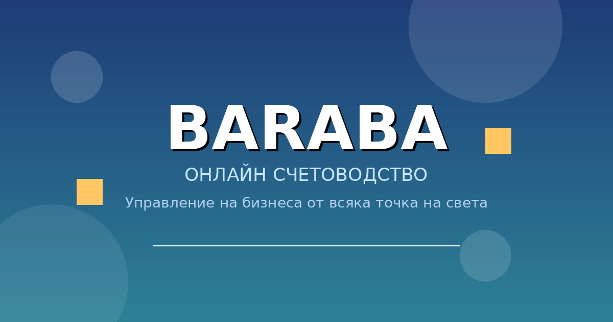

<p align="center"></p>

# Счетоводна програма - Baraba leptos

Счетоводно приложение за български фирми. Производство: https://baraba.org.

Backend е Crystal 1.17.0 (Lucky, Avram) и PostgreSQL 16. Frontend е Leptos WASM. Двата образа се събират от `docker-compose.prod.yml`. Caddy раздава сайта.

```bash
docker compose -f docker-compose.prod.yml build backend frontend
docker compose -f docker-compose.prod.yml up -d backend frontend
```

Чакащите миграции се прилагат при старт на backend. Контейнерът на базата не се пресъздава при тази команда.

Входът е JWT в `Authorization: Bearer`. Токенът стои в браузъра (`localStorage`, ключ `auth_token`). По желание потребителят включва TOTP от профила. Фирмените данни са под `/api/companies/:company_id/` и искат супер администратор, собственик или роля във фирмата.

ДДС файловете за НАП, SAF-T и UBL се свалят с този токен. Архивът иска отделно парола на супер администратор.

Настройките са в корневия `.env`: `DATABASE_URL`, `SECRET_KEY_BASE`, `POSTGRES_PASSWORD`, `LUCKY_ENV=production`.

Документацията е в [docs/README.md](docs/README.md).
