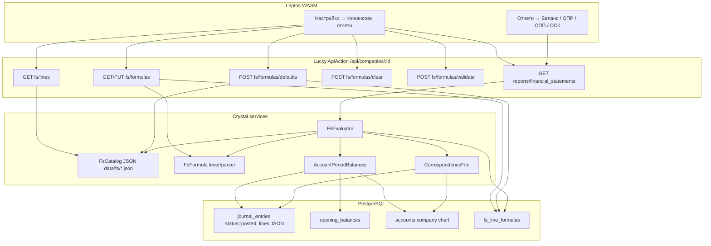
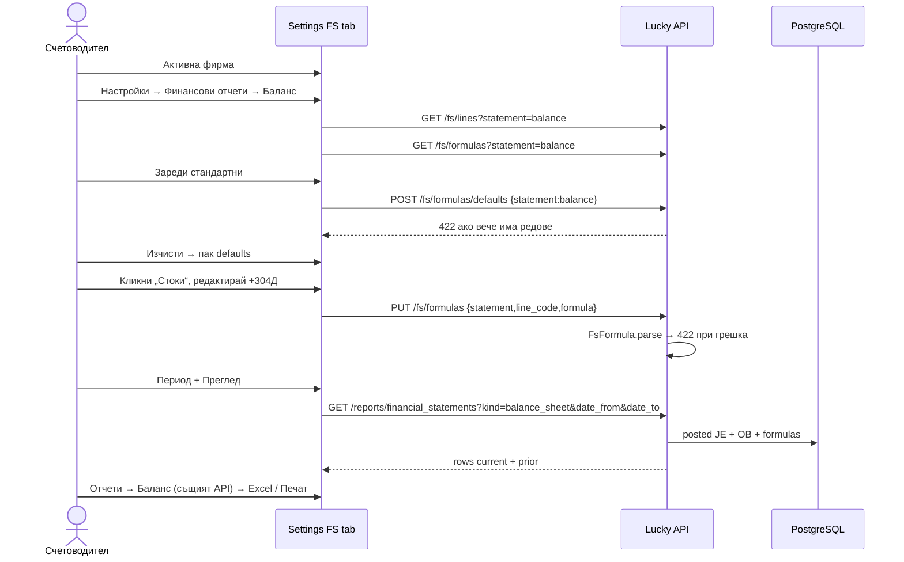

# Годишни финансови отчети по СС 1 (НСС-1) в Baraba

| Поле | Стойност |
|------|----------|
| **Документ** | Design: ГФО по СС 1 |
| **Автор** | — |
| **Дата** | 2026-09-11 |
| **Статус** | Draft (rev. 3, след review) |
| **Стек** | Crystal / Lucky / Avram / PostgreSQL + Leptos 0.8 WASM |
| **Продуктов модел** | bagabuch `docs/financial-statements.md` @ `10cea2fa` — порт на поведението, не на езика |

---

## Overview

Baraba има дневник, начални салда, оборотна ведомост и SAF-T номенклатури, но **няма** годишен финансов отчет (ГФО). Счетоводителят трябва да състави четирите бланки по **СС 1 — Представяне на финансови отчети** (ДВ бр. 3/2016): счетоводен баланс (Приложение 1, двустранен), отчет за приходите и разходите по икономически елементи (Приложение 2), отчет за паричните потоци по прекия метод (СС 7 / СС 1 т. 23) и отчет за собствения капитал (Приложение 4, колона „общо“).

Предложението повтаря продуктовия модел на bagabuch: **фиксирано дърво от статии** (каталог в кода/JSON, като SAF-T), а счетоводителят пълни всяка листова статия с **формула** на език `+304Д-241К+702ОК+50*Д/411К+@bal.c.i.t` — не Excel. Формулите са per-company в нова таблица `fs_line_formulas`. Двигателят преизползва същата дефиниция за начално/оборот/крайно като оборотната ведомост (posted `journal_entries.lines` JSON + `opening_balances`) и FIFO двойки Дт/Кт за кореспонденции. Настройки живеят в **Настройки на фирма → Финансови отчети**; готовият отчет е в **Отчети**.

---

## Background & Motivation

### Текущо състояние в Baraba

| Способност | Къде е днес | Ограничение спрямо ГФО |
|------------|-------------|-------------------------|
| Оборотна ведомост | `backend/src/actions/api/reports/trial_balance.cr` | 6 колони по сметка; **нетира** крайното салдо; `get_opening_balance` взима `.first?` от `opening_balances` **без** обороти от 1 януари до `date_from` |
| Картон на сметка | `account_ledger.cr` | Начално = всички OB + **всички** posted записи преди `from` (не само календарната година) |
| Хронологична справка | `chronological.cr` | Двойки Дт/Кт чрез `shift?` на първия кредит — **не** FIFO с остатъци |
| SAF-T кореспонденции | `SaftMovementAccountMapping#matches?`, `SaftMovementMapper` | Шаблон `304` / `30*`; извличането е декартово произведение `min(dt, kt)` — **двойно броене** |
| Настройки фирма | `leptos/src/pages/settings.rs` (~1980 реда) | Табове 0–6: Фирма, Сметки, SAFt, Функции, Интеграции, Дивиденти, Колеги. Няма ГФО. |
| Отчети UI | `leptos/src/pages/reports.rs` (~1580 реда) | `trial_balance`, `trial_balance_counterpart`, `chronological`, `account_ledger`, `general_ledger`. Excel (SheetJS) + Печат/PDF (`window.print`). Няма сървърен PDF/ODS. |
| Дневник | `JournalEntry.lines` JSON `{account_id, account_code, debit, credit, description}`; `status` `draft`/`posted`/`reversed` | Таблицата `journal_lines` често е празна — справките четат JSON през `JournalLines.parse` |
| Сметкоплан | `CompanyAccountsInitializer` копира SAF-T НСФО кодове (201, 304, 401, 411, 501, 503, 601, 701, 241/242, 101, 123…) | Аналитични продължения (`50301`, `60101`) съществуват |
| Права | `Permission::ACCOUNTING_READ/WRITE`, `REPORT_READ` в `backend/src/models/permission.cr` | Почти никое API action не вика `authorize!` — само JWT |

### Болки

- ГФО се прави на ръка от оборотна ведомост — грешки при нетиране на амортизация (241/242), пропуснати аналитични сметки, липса на кореспонденции за ОПП.
- Няма място, където счетоводителят да каже „стоки = `+304Д`“, „нетни приходи = `+701ОК+702ОК+703ОК`“.
- СС 1 т. 11.4 изисква скриване на нулеви редове при публикуване; т. 15.2 фиксира двустранната бланка.

### Защо не порт на bagabuch 1:1

bagabuch е Baga + React. Baraba е Crystal/Lucky + Leptos. Пренасяме **продуктовото поведение** (бланки, език на формулите, FIFO, defaults, UX поток), реализирано с Avram модели, Lucky `ApiAction` и Leptos компоненти. Изходният код на bagabuch (`backend/models/fs_nom_*.baga`, `fs_formula.baga`, `actions/reports_fs.baga`) е спецификация, не файл за copy-paste.

---

## Goals & Non-Goals

### Goals (v1)

1. Четирите бланки по СС 1 / СС 7 с **нередактируемо дърво** и per-company формули.
2. Формулен език идентичен с bagabuch: `Д`/`К` (крайно, без нетиране), `ОД`/`ОК` (оборот), `НД`/`НК` (начално към `from`), `Д/К` кореспонденция, `@code` към друга статия от същата бланка, шаблон `304` / `30*`.
3. Настройки: таб **Финансови отчети** с подтабове Баланс / ОПР / Паричен поток / Собствен капитал; Зареди стандартни / Изчисти / редакция / преглед за период.
4. Справки: четири нови `kind` в съществуващата страница Отчети; Excel + Печат/PDF по сегашния клиентски път.
5. Колона **предходна година в v1** (виж Key Decisions).
6. Споделен двигател за салда/обороти, който ГФО и (в follow-up) оборотната ведомост ползват с **еднаква** дефиниция.
7. Валидация на формула при запис → HTTP 422.
8. Само `status = "posted"` записи; `draft`/`reversed` не влизат.

### Non-Goals (v1)

| Изрично извън обхват | Защо |
|----------------------|------|
| ОПР по функция (СС 1 Приложение 3) | Друга бланка, друг набор формули |
| Съкратен баланс за малки (Приложение 6) | Не е евтино: отделно дърво + правила за микро/малки по ЗСч. **Не влиза в v1.** |
| Справка за ДМА (Приложение 5) | Има отделен модул `fixed_assets` |
| Приложение към ГФО (бележки, СС 1 т. 24) | Текст/оповестявания, не формули |
| Нови статии по СС 1 т. 11.2–11.3 (потребителски редове) | Каталогът е фиксиран |
| Закръгляне към хиляди по бланката | Суми = евро, 2 знака (`company.currency`, default `EUR`) |
| Сървърен PDF / XLSX / ODS | Отчетите вече имат SheetJS + `window.print`. Не блокираме v1. |
| Косвен метод за ОПП | СС 7 т. 3 изисква пряк метод |
| Матричен ОСК (колони по компонент на капитала) | Само колона „общо“, както bagabuch |
| Справка „По кореспонденции“ (главна книга по двойки) | Полезна, но отделна справка; FIFO се прави като **споделена услуга**, справката може да е PR след ГФО |
| Форсиране Актив = Пасив | Диагностика, не валидация |
| Excel-формули, скоби, приоритет | Езикът е ляво-надясно сбор на токени |

---

## Key Decisions

1. **Продуктов модел = bagabuch, реализация = Baraba.** Формулен език, кодове на статии (`bal.b.ii.1`, `pl.e.2a`, `cf.op.in.cust`, `eq.open`) и UX поток се пренасят. Кодът е Crystal/Leptos.

2. **Каталогът е JSON.** Source: `backend/data/fs/*.json`. Runtime load: CWD-relative `data/fs/*.json` — същото като `Api::SaftAccounts::Load` (`csv_path = "data/NRA_Nom_Accounts.csv"`). Docker `COPY backend/data ./data` с `WORKDIR /app`. `lucky watch` от `backend/` също вижда `data/`. Липсващ файл → exception при старт, не празен отчет. `FsCatalog.clear_cache` за specs. Официалните етикети от paywalled balans.bg са copy-edit follow-up, **не** blocker за PR 1: PR 1 сериализира `fs_nom_*.baga` @ `10cea2fa` + изброените допълнения към Прил. 1.

3. **Формулите са per-company в `fs_line_formulas`.** Unique `(company_id, statement, line_code)`. Празна формула = 0. Сборен ред без формула сумира сестрински `line`/`total` под същия `parent` (**без** децата на тези сестри — „в т.ч.“ са вложени под номера, не под групата). Всеки `total` с формула **презаписва** auto-sum; затова всеки нов `line` влиза в parent `@` формулата (виж `eq.close`, `cf.op.net`).

4. **Предходна година — ДА в v1.** NSS-1 бланките имат колони „текуща / предходна“. Цената е втори проход на същия двигател с `from-1 year` / `to-1 year`. Default: включена. Query `include_prior`: omitted/`1`/`true`/`yes` → да; `0`/`false`/`no` → не.

5. **Споделен `AccountPeriodBalances`, не копие на `trial_balance.cr`.** Днешната оборотна ведомост **нетира** КД/КК и **не** добавя YTD към началното. Формулите `+304Д` и `-241К` изискват **ненетирани** страни. Извличаме примитив `{НД, НК, ОД, ОК}` с дефиницията на bagabuch; ГФО го ползва веднага; оборотната ведомост се прехвърля в отделен PR.

6. **FIFO кореспонденции — нова услуга `CorrespondenceFifo`, не `chronological.cr` и не `SaftMovementMapper`.** Хронологията прави `credit_lines.shift?` (1:1 без остатъци). SAF-T mapper прави декартово `min`. ГФО ползва алгоритъма от bagabuch `reports_fs.baga`: остатъци, `min(debit_rem, credit_rem)`.

7. **JSON `journal_entries.lines` е източникът**, през `JournalLines.parse` / `debit` / `credit` / `resolve_account_id` — същият път като оборотната ведомост. Таблицата `journal_lines` не се изисква (spec вече документира JSON-only posted записи).

8. **Права (backend):** четене `accounting:read` ∪ `report:read`; запис `accounting:write` ∪ `settings:update`. `POST validate` е четене. **Не** `raise authorize!` (Lucky → 500). Call site: `if denied = forbid_unless_any!(...); return denied; end` с `json(..., status: 403)`. PR 3 добавя `Errors::Show` render като мрежа. Без `SkipRequireAuthToken`. WASM gating е по **име на роля** (KD 14), не по permission strings.

9. **Приложение 6 (съкратен баланс) — out of scope.** Отделно дърво + прагове по ЗСч.

10. **Експорт v1 = съществуващият Excel + Печат/PDF.** Без нов сървърен renderer. Редове с `hidden_in_export` (current=0 и prior=0) се **филтрират от DOM преди SheetJS и преди print** — не само print CSS (SheetJS чете on-screen таблицата).

11. **Печалба/загуба в ОПР: post-eval clamp `max(0, x)`** върху `pl.e.profit` и `pl.i.loss`. Езикът няма `IF`/`MAX`. Без clamp и двете страни могат да са ненулеви (загубата bagabuch даже игнорира данъка). NSS-1 Прил. 2 показва едното **или** другото като положителна балансираща статия.

12. **ГФО важи след приключване към 123.** `bal.p.a.vi = +123К-123Д` е 0, докато 6xx/7xx не са прехвърлени. Rollout и UI hint го казват. Diagnostics: `current_result_123` (`bal.p.a.vi`) vs `pl_profit` (`pl.e.profit`).

13. **`POST defaults` в v1 отказва, ако има редове; плюс `mode=fill_empty`.** `fill_empty` вмъква само липсващи `line_code` (каталожен patch след ship). Не пипа съществуващи формули. Не копираме SAF-T CreateDefaults (200 + `success:false`, skip auth).

14. **Таб „Финансови отчети“ (WASM няма permission strings).** `GET /api/auth/me` връща само `company_roles[].role` (име); `UserContext` има `is_admin_for_company?`, **няма** списък права. v1 **не** разширява `/me`. Табът е видим за всеки член на активната фирма (като табове 0–5). Зареди/Изчисти/Запази са `disabled`, когато `role_for_company == "viewer"` или `"observer"`; `admin` / `accountant` / `super_admin` пишат. Backend 403 остава източник на истина (admin минава чрез `settings:update`).

15. **`AccountPeriodBalances.compute(company_id, from, to)` е един период.** Няма `prior_from` вътре (предходната година = втори `compute`). SQL: `entry_date >= opening_je_start AND entry_date <= to`, където `opening_je_start = snapshot_date || fiscal_start(from)`. Inactive сметки: в chart lookup; в резултата само при ненулево OB или оборот.

16. **`AccountPattern` е ново копие на prefix правилото.** `SaftMovementAccountMapping#matches_pattern?` остава private и непроменен в v1.

---

## Proposed Design

### Архитектура



### Поток на счетоводителя



### Формулен език (порт на `fs_formula.baga`)

Лексер, ляво-надясно, **без скоби и приоритет**. Празен низ → 0 токена → стойност 0.

**Граматика (неформално):**

```
formula  := [sign] token (sign token)*
sign     := '+' | '-'          # само ASCII (bagabuch char 43/45). Unicode − → 422
token    := '@' line_code
          | account_pat kind
          | account_pat kind '/' account_pat kind
kind     := 'ОД' | 'ОК' | 'НД' | 'НК' | 'Д' | 'К'   # UTF-8 string match, не byte length
account_pat := digit+ '*'?     # 304, 3041, 30*, 50*
line_code   := [A-Za-z0-9.]+   # bal.c.i.t
```

Лимити в парсера (не само в Security): формула > 500 символа или > 64 токена → 422 `формулата е твърде дълга`. Първият токен може без знак (= плюс). Следващите **задължително** имат ASCII `+`/`-`. Интервалите се игнорират. `kind` се чете с `starts_with?("ОД")` и т.н. върху UTF-8 низ (Crystal `String#size` е codepoints; **не** порт на bagabuch `fs_kind_len` в байтове — `ОД` е 2 символа / 4 байта). Вътрешен запис на токен (като bagabuch):

| Вход | Вътрешен токен | Значение |
|------|----------------|----------|
| `+304Д` | `+ \| 304 \| D` | крайно дебит = НД+ОД (ненетирано) |
| `-241К` | `- \| 241 \| C` | крайно кредит, с минус |
| `+702ОК` | `+ \| 702 \| TC` | оборот кредит в `[from, to]` |
| `+601ОД` | `+ \| 601 \| TD` | оборот дебит |
| `+101НК` | `+ \| 101 \| OC` | начално кредит към `from` |
| `+123НД` | `+ \| 123 \| OD` | начално дебит |
| `+304Д/401К` | `+ \| 304 \| CORR \| 401` | FIFO сума на двойки Дт 304 / Кт 401 |
| `+50*Д/411К` | `+ \| 50* \| CORR \| 411` | префикс |
| `+@bal.c.i.t` | `+ \| @ \| bal.c.i.t` | стойност на статия от **същата** бланка |

`ОД`/`ОК`/`НД`/`НК` се разпознават **преди** голите `Д`/`К` (иначе `ОД` би се чело като `Д`).

**Шаблон на сметка** — същото правило като `SaftMovementAccountMapping#matches_pattern?`:

```crystal
# backend/src/services/account_pattern.cr
# Копие на prefix правилото от SaftMovementAccountMapping#matches_pattern?
# (без analytical аргумента). SAF-T mapping-ът НЕ се пипа в v1.
module AccountPattern
  def self.matches?(account : String, pattern : String) : Bool
    return false if pattern.empty?
    if pattern.ends_with?("*")
      account.starts_with?(pattern.rchop("*"))
    else
      account == pattern || account.starts_with?(pattern)
    end
  end
end
```

`304` хваща `304`, `3041`, `30401`. `30*` хваща целия клас 30x. Това е съзнателно — националният сметкоплан държи аналитичните като продължение на синтетичния код.

**Кореспонденция:** парсерът изисква `kind` и от двете страни, но при оценка **конвенцията е винаги първа сметка = дебит, втора = кредит**, независимо дали е писано `Д` или `К`. При запис: ако първата страна не е Д-семейство (`Д`/`ОД`/`НД`) или втората не е К-семейство — 422 с „кореспонденцията е Дт/Кт (напр. +304Д/401К)“. Това затваря капана `+304К/401Д`, който bagabuch мълчаливо третира като Дт 304 / Кт 401.

**`@` референции** само към кодове от същата бланка; при запис неизвестен код → 422. Цикли се хващат в evaluator (guard), не при parse.

**Грешки при parse (422, български текст, като bagabuch):**

- `очакван знак + или -` (ASCII; Unicode minus `−` се отхвърля със същото съобщение)
- `формулата свършва след знака`
- `липсва код след @`
- `липсва сметка`
- `липсва Д/К/ОД/ОК/НД/НК след 304`
- `липсва кредитна сметка след /`
- `непозната статия @bal.zzz`
- `кореспонденцията е Дт/Кт (напр. +304Д/401К)`

### Салда и обороти — `AccountPeriodBalances`

**Целева дефиниция** (bagabuch / СС 1 т. 15.1, същата като „правилната“ оборотна ведомост):

| Мярка | Дефиниция | Формулен kind |
|-------|-----------|----------------|
| **Начално** към `from` | Snapshot OB (`latest date ≤ fiscal_start`) + posted JE в `[opening_je_start, from)` | `НД`/`НК` → `OD`/`OC` |
| **Оборот** | Posted редове с `entry_date` в затворения интервал `[from, to]` | `ОД`/`ОК` → `TD`/`TC` |
| **Крайно ненетирано** | `НД+ОД` и `НК+ОК` поотделно; **без** прехвърляне Дт↔Кт | `Д`/`К` → `D`/`C` |

Отрицателен оборот (сторно, кредитно известие) е валиден и намалява съответната страна — `JournalLines.debit` вече връща отрицателни Float64.

**Фискално начало, съдържащо `from`:**

```crystal
fy = company.fiscal_year_start_month  # 1..12, default 1
y  = from.month >= fy ? from.year : from.year - 1
fiscal_start = Time.utc(y, fy, 1)
```

OB е snapshot към **началото на деня** `date` (преди журнала за този ден). Unique index: `(company_id, account_id, date, coalesce(counterpart_id,0), coalesce(product_id,0), coalesce(warehouse_id,0))` (`20250129000001_add_subledger_to_opening_balances.cr`).

**Детерминистична процедура (една snapshot дата на сметка):**

Едно правило, ползвано **само** от `compute(from, to)` (предходна година = друг `compute`, без `prior_from` в този модул):

1. `snapshot_date` = max `{ob.date | account = A ∧ ob.date ≤ fiscal_start}`. Липса → няма snapshot.
2. **НД/НК** = сума на аналитичните OB редове за A с `date == snapshot_date` (0 ако няма snapshot).
3. `opening_je_start = snapshot_date || fiscal_start`. Posted JE с `opening_je_start ≤ entry_date < from` се добавят към НД/НК. **Няма** „цялата история преди `from`“ (това е `account_ledger.cr`).
4. **ОД/ОК** = posted JE с `from ≤ entry_date ≤ to`.
5. SQL за този `compute`: `status=posted AND entry_date >= opening_je_start AND entry_date <= to`. Разделянето opening vs turnover е в паметта на `from`.
6. Сметки в резултата: ненулево OB или оборот, **вкл. неактивни**. Chart lookup включва неактивни за `account_id` → `code`.

Не сумираме няколко snapshot дати. Не ползваме `trial_balance.cr#get_opening_balance`. Не ползваме `account_ledger.cr`.

**Примери (PR 2 spec):**

| # | Ситуация | fiscal_start | snapshot | `opening_je_start` | opening JE | turnover |
|---|----------|--------------|----------|--------------------|------------|----------|
| (a) | Календарен ГФО `from=2025-01-01` `to=2025-12-31`, fy=1, OB 2025-01-01 | 2025-01-01 | 2025-01-01 | 2025-01-01 | празно (`< from`) | цялата 2025 |
| (b) | Mid-year `from=2025-06-01` `to=2025-06-30`, OB 2025-01-01 | 2025-01-01 | 2025-01-01 | 2025-01-01 | ян–май | юни |
| (c) | FY от април, interim `from=2026-01-01`, fy=4, OB 2025-04-01 | 2025-04-01 | 2025-04-01 | 2025-04-01 | 2025-04-01…12-31 | януари 2026 |
| (d) | Няма OB за 2025; latest `date≤fiscal_start` е 2024-01-01 | 2025-01-01 | 2024-01-01 | 2024-01-01 | 2024-01-01…`from`-1 | `[from,to]` |
| (e) | Няма никакъв OB | 2025-01-01 | — | `fiscal_start` | `[fiscal_start, from)` | `[from,to]` |

**Нетиране:** `trial_balance.cr` редове 129–134 смятат `closing_balance = (НД−НК)+(ОД−ОК)` и слагат цялото салдо в КД **или** КК. За ГФО това е грешно: амортизация 241 трябва да остане кредит, за да може `-241К` да нетира брутния ДМА. Двигателят пази четирите числа отделно.

Интерфейс:

```crystal
# backend/src/services/account_period_balances.cr
struct AccountPeriodBalances
  struct Row
    getter account_id : Int64
    getter code : String
    getter opening_debit : Float64   # НД към from
    getter opening_credit : Float64  # НК
    getter turnover_debit : Float64  # ОД в [from,to]
    getter turnover_credit : Float64 # ОК

    def closing_debit : Float64
      (opening_debit + turnover_debit).round(2)
    end

    def closing_credit : Float64
      (opening_credit + turnover_credit).round(2)
    end
  end

  def self.compute(company_id : Int64, date_from : Time, date_to : Time) : Hash(String, Row)
    # Един период. Няма prior_from.
    # opening_je_start = snapshot_date || fiscal_start(date_from)
    # SQL: posted, entry_date >= opening_je_start, entry_date <= date_to
  end
end
```

Производителност: един SQL прозорец на `compute(from,to)`. Очакване: 2–10k JE/година < 1 s; 50k < 3–5 s. Текущ + предходен = **два независими** `compute` в `FsEvaluator` (не един scan с `prior_from` в balances). Без кеш таблица в v1.

**Филтър по дата:** `entry_date` (счетоводна), **не** `document_date`. Хронологията филтрира по document_date — ГФО и ОВ по entry_date. Еднакво с `trial_balance.cr:42-50`.

### FIFO кореспонденции — `CorrespondenceFifo`

```crystal
module CorrespondenceFifo
  record Pair, debit_code : String, credit_code : String, amount : Float64

  # Един списък на период. Evaluator го вика веднъж, не per token.
  def self.pairs(company_id : Int64, from : Time, to : Time, accounts_by_id : Hash(Int64, String), accounts_by_code : Hash(String, Int64)) : Array(Pair)
end
```

**Вход:** posted `JournalEntry` с `from ≤ entry_date ≤ to` (SQL филтър). Не OB. Групиране = **един запис**.

**Извличане на линия (задължително `JournalLines`, не `as_f?`):**

1. `lines = JournalLines.parse(entry.lines)` — редът в JSON масива е FIFO редът.
2. `code` = `JournalLines.account_code(line)` ако непразен, иначе `accounts_by_id[JournalLines.account_id(line)]`. Ако и двете липсват → skip линията (warning `липсва сметка в запис #{entry.id}`).
3. `d = JournalLines.debit(line)`, `c = JournalLines.credit(line)` (Float64/Int64/String и `debit_amount`/`credit_amount`).
4. Линия с **и двете** `d > 0` и `c > 0`: влиза в **двата** списъка (дебитна опашка с `d`, кредитна с `c`). Рядко в Baraba JSON.
5. v1 опашки: само `d > 0` / `c > 0`. `rem <= 0` се skip-ва. Отрицателни обороти (сторно) **не** влизат в FIFO (влизат в НД/ОД през `AccountPeriodBalances`). Документиран лимит спрямо bagabuch lines table.

**Алгоритъм на запис** (остатъци, `pair = min(d.rem, c.rem)` — неотрицателни; **не** `min_by_abs`):

```
debits[]  = {code, rem: d} за всяка линия с d > 0, в JSON ред
credits[] = {code, rem: c} за всяка линия с c > 0, в JSON ред
di = 0; ci = 0
while di < debits.size && ci < credits.size
  skip / di++ ако debits[di].rem <= 0
  skip / ci++ ако credits[ci].rem <= 0
  amt = min(debits[di].rem, credits[ci].rem).round(2)
  emit Pair(debits[di].code, credits[ci].code, amt)
  debits[di].rem -= amt
  credits[ci].rem -= amt
end
# leftover (небалансиран запис): drop, без warning в v1
```

**Не** декартово `min(dt,kt)` от `SaftMovementMapper`. **Не** `credit_lines.shift?` от `chronological.cr`.

Оценка на `+304Д/401К`: сума на `Pair`, за които `AccountPattern.matches?(debit_code,"304") && AccountPattern.matches?(credit_code,"401")`.

**PR 2 fixture (доказва FIFO ≠ cartesian):**

JSON: Dt 304 100, Dt 4531 20, Ct 401 80, Ct 4532 40.

| Алгоритъм | Двойки | Σ |
|-----------|--------|---|
| FIFO (задължителен) | `(304,401,80), (304,4532,20), (4531,4532,20)` | 120 |
| Cartesian min | 4 двойки, сума 240 | 240 |
| 2 Dt × 1 Ct покупка 304/4531/401 | FIFO **и** cartesian дават 2 двойки със сума = кредита — **не** различава | — |

Втори fixture: линия само с `account_id` (без `account_code`) → resolve през chart.

### Evaluator — `FsEvaluator`

```mermaid
flowchart LR
  Cat[Каталог на бланката] --> Loop
  Fmap[fs_line_formulas] --> Loop
  Bal[НД НК ОД ОК по код] --> Token
  Pairs[FIFO двойки] --> Token
  Loop{всеки код още не done}
  Loop -->|header без формула| Zero[val=0 done]
  Loop -->|line празна формула| Zero
  Loop -->|total празна формула| SumSiblings[сбор сестри line/total]
  Loop -->|има формула| Parse
  Parse --> Token
  Token -->|@ref не ready| Wait
  Token -->|готово| Acc[ляво-надясно +/- round 2]
  SumSiblings -->|сестра не ready| Wait
  Acc --> Done
  Wait --> Guard{progress? max n+4}
  Guard -->|застой| Unresolved[остатък = 0 + warning]
```

Правила, идентични с bagabuch `rpt_fs_build`:

- `header` без формула → 0 (етикет).
- `line` без формула → 0.
- `total` без формула → сбор на сестри с `kind ∈ {line, total}` под същия `parent` (не включва себе си, не включва header).
- Формула върху total **презаписва** автоматичния сбор (напр. `bal.t` = `+@bal.a+@bal.b.t+@bal.c.t+@bal.d`).
- `@` към още несметната статия → изчаква следваща итерация.
- След `ncat+4` итерации без прогрес: несметнатите = 0, `warnings: ["цикъл или липсваща референция: …"]`.
- Грешна формула в БД (не трябва да се случи след 422) → 0 за този ред.

Точност: натрупване в Float64, `.round(2)` на всеки токен и на крайната статия. Без Decimal в v1 (целият дневник е Float64).

`FsEvaluator.compute(company_id, statement, from, to) : Result` строи **веднъж** `AccountPeriodBalances` и **веднъж** `CorrespondenceFifo.pairs` за периода, после оценява всички статии.

Предходна година: втори `compute` с `prior_from = date_from.shift(years: -1)`, `prior_to = date_to.shift(years: -1)` (29 фев → 28 фев). Ако `include_prior` е false, `prior = 0` без втори compute.

**Post-eval clamp (ОПР):** след топологията, `pl.e.profit = max(0, val)` и `pl.i.loss = max(0, val)`. Без това и двете страни са ненулеви (bagabuch `pl.i.loss` даже не вади данъка). Езикът няма `IF`.

СС 1 т. 11.4: ред с `current==0 && prior==0` получава `hidden_in_export: true`. Настройките показват цялото дърво. Справката на екрана показва всички редове; **Excel и Печат филтрират** `hidden_in_export` преди DOM/SheetJS. Header се експортира ако има видим потомък.

**Diagnostics** (само `kind=balance_sheet` за активите; ОПР винаги):

```json
"diagnostics": {
  "asset_total": 10000.00,
  "liability_total": 10000.00,
  "delta": 0.00,
  "current_result_123": 1200.00,
  "pl_profit": 1200.00
}
```

`asset_total` = `bal.t`, `liability_total` = `bal.p.t`, `delta` = актив − пасив, `current_result_123` = `bal.p.a.vi`, `pl_profit` = `pl.e.profit` (clamp-нат; за баланс-справка се смята само ако формулите за `pl` не се дърпат — v1: полето се пълни **само** при `income_statement`; при баланс само asset/liability/delta). UI жълт банер ако `|delta| ≥ 0.01`.

**Каталожен инвариант (spec в PR 1) — не „всеки non-header до statement total“:**

1. Всеки group/section `total` с `@` формула изброява **точно** номерираните си деца (без внуци „в т.ч.“). Празен total → auto-sum на директни сестри `line`/`total`.
2. Grandchild „в т.ч.“ (`bal.b.ii.1a`, `pl.e.2a`, `pl.i.1a`…) са **нарочно извън** group `@`. Родителят им е `line` със собствена формула (`bal.b.ii.1 = +201Д+202Д-242К`). Не ги пъхаме в `bal.b.ii.t` — това връща двойното броене.
3. ОПР `pl.e.tax`, `pl.e.profit`, `pl.i.loss` са **балансиращи редове на бланката**, не компоненти на `pl.e.t` / `pl.i.t` (`pl.e.t = +@pl.e.op+@pl.e.fin`). `pl.e.profit` ползва `@pl.e.t` и `@pl.e.tax` отделно.

`fs_catalog_spec.cr` кодира (1)–(3), не reachability от `bal.t` към всяка `line`.

### Каталог на бланките (NSS-1)

PR 1 **сериализира** bagabuch `fs_nom_*.baga` @ `10cea2fa` плюс изброените допълнения. Официалната формулировка на етикетите е copy-edit follow-up, не blocker.

**Runtime path:** `FsCatalog.load` чете `data/fs/{balance,pl,cashflow,equity}.json` и `data/fs/defaults_*.json` (CWD-relative). Source в repo: `backend/data/fs/`. Липса → raise. Class-level cache; `FsCatalog.clear_cache` в spec `before_each`.

```json
{"code":"bal.b.ii.1a","parent":"bal.b.ii.1","kind":"line","side":"asset","name":"— земи"}
```

`kind`: `header` | `line` | `total`. Празен `parent` = корен.

**Правило против двойно броене:** „в т.ч.“ (`1a`/`1b`/`3a`/`3b`/`pl.e.2a`…) имат `parent` = номерираната статия, **не** групата. Group `total` без формула сумира само директните сестри `line`/`total` (1+2+3+4, не 1+1a+1b). Допълнително defaults дават явни `@` формули на всеки `total`, за да не зависи инвариантът само от auto-sum.

#### Баланс — `statement=balance` — СС 1 Приложение 1

bagabuch `fs_nom_balance.baga` + допълненията с `†`. `bal.p.a.v` е **header** (не line).

**Актив** (`side=asset`)

| code | parent | kind | Име |
|------|--------|------|-----|
| `bal.a` | | line | А. Записан, но невнесен капитал |
| `bal.b` | | header | Б. Нетекущи (дълготрайни) активи |
| `bal.b.i` | `bal.b` | header | I. Нематериални активи |
| `bal.b.i.1` | `bal.b.i` | line | 1. Продукти от развойна дейност |
| `bal.b.i.2` | `bal.b.i` | line | 2. Концесии, патенти, лицензии, търговски марки, програмни продукти и други подобни права и активи |
| `bal.b.i.3` | `bal.b.i` | line | 3. Търговска репутация |
| `bal.b.i.4` | `bal.b.i` | line | 4. Предоставени аванси и нематериални активи в процес на изграждане |
| `bal.b.i.t` | `bal.b.i` | total | Общо за група I |
| `bal.b.ii` | `bal.b` | header | II. Дълготрайни материални активи |
| `bal.b.ii.1` | `bal.b.ii` | line | 1. Земи и сгради |
| `bal.b.ii.1a` | `bal.b.ii.1` | line | — земи |
| `bal.b.ii.1b` | `bal.b.ii.1` | line | — сгради |
| `bal.b.ii.2` | `bal.b.ii` | line | 2. Машини, производствено оборудване и апаратура |
| `bal.b.ii.3` | `bal.b.ii` | line | 3. Съоръжения и други |
| `bal.b.ii.4` | `bal.b.ii` | line | 4. Предоставени аванси и ДМА в процес на изграждане |
| `bal.b.ii.t` | `bal.b.ii` | total | Общо за група II |
| `bal.b.iii` | `bal.b` | header | III. Дългосрочни финансови активи |
| `bal.b.iii.1` | `bal.b.iii` | line | 1. Акции и дялове в предприятия от група |
| `bal.b.iii.2` | `bal.b.iii` | line | 2. Предоставени заеми на предприятия от група † |
| `bal.b.iii.3` | `bal.b.iii` | line | 3. Акции и дялове в асоциирани и смесени предприятия † |
| `bal.b.iii.4` | `bal.b.iii` | line | 4. Предоставени заеми на асоциирани и смесени предприятия † |
| `bal.b.iii.5` | `bal.b.iii` | line | 5. Дългосрочни инвестиции |
| `bal.b.iii.6` | `bal.b.iii` | line | 6. Други заеми |
| `bal.b.iii.7` | `bal.b.iii` | line | 7. Изкупени собствени акции † |
| `bal.b.iii.t` | `bal.b.iii` | total | Общо за група III |
| `bal.b.iv` | `bal.b` | line | IV. Отсрочени данъци |
| `bal.b.t` | `bal.b` | total | Общо за раздел Б |
| `bal.c` | | header | В. Текущи (краткотрайни) активи |
| `bal.c.i` | `bal.c` | header | I. Материални запаси |
| `bal.c.i.1` | `bal.c.i` | line | 1. Суровини и материали |
| `bal.c.i.2` | `bal.c.i` | line | 2. Незавършено производство |
| `bal.c.i.3` | `bal.c.i` | line | 3. Продукция и стоки |
| `bal.c.i.3a` | `bal.c.i.3` | line | — продукция |
| `bal.c.i.3b` | `bal.c.i.3` | line | — стоки |
| `bal.c.i.4` | `bal.c.i` | line | 4. Предоставени аванси |
| `bal.c.i.t` | `bal.c.i` | total | Общо за група I |
| `bal.c.ii` | `bal.c` | header | II. Вземания |
| `bal.c.ii.1` | `bal.c.ii` | line | 1. Вземания от клиенти и доставчици |
| `bal.c.ii.2` | `bal.c.ii` | line | 2. Вземания от предприятия от група † |
| `bal.c.ii.3` | `bal.c.ii` | line | 3. Вземания от асоциирани и смесени предприятия † |
| `bal.c.ii.4` | `bal.c.ii` | line | 4. Други вземания |
| `bal.c.ii.t` | `bal.c.ii` | total | Общо за група II |
| `bal.c.iii` | `bal.c` | header | III. Инвестиции |
| `bal.c.iii.1` | `bal.c.iii` | line | 1. Акции и дялове в предприятия от група † |
| `bal.c.iii.2` | `bal.c.iii` | line | 2. Изкупени собствени акции † |
| `bal.c.iii.3` | `bal.c.iii` | line | 3. Други инвестиции |
| `bal.c.iii.t` | `bal.c.iii` | total | Общо за група III |
| `bal.c.iv` | `bal.c` | header | IV. Парични средства |
| `bal.c.iv.a` | `bal.c.iv` | line | — в брой |
| `bal.c.iv.b` | `bal.c.iv` | line | — в безсрочни сметки (депозити) |
| `bal.c.iv.t` | `bal.c.iv` | total | Общо за група IV |
| `bal.c.t` | `bal.c` | total | Общо за раздел В |
| `bal.d` | | line | Г. Разходи за бъдещи периоди |
| `bal.t` | | total | Сума на актива (А+Б+В+Г) |

**Пасив** (`side=liability`)

| code | parent | kind | Име |
|------|--------|------|-----|
| `bal.p.a` | | header | А. Собствен капитал |
| `bal.p.a.i` | `bal.p.a` | line | I. Записан капитал |
| `bal.p.a.ii` | `bal.p.a` | line | II. Премии от емисии |
| `bal.p.a.iii` | `bal.p.a` | line | III. Резерв от последващи оценки |
| `bal.p.a.iv` | `bal.p.a` | header | IV. Резерви |
| `bal.p.a.iv.1` | `bal.p.a.iv` | line | 1. Законови резерви |
| `bal.p.a.iv.2` | `bal.p.a.iv` | line | 2. Резерв, свързан с изкупени собствени акции † |
| `bal.p.a.iv.3` | `bal.p.a.iv` | line | 3. Резерв съгласно учредителен акт † |
| `bal.p.a.iv.4` | `bal.p.a.iv` | line | 4. Други резерви |
| `bal.p.a.iv.t` | `bal.p.a.iv` | total | Общо за група IV |
| `bal.p.a.v` | `bal.p.a` | header | V. Натрупана печалба (загуба) от минали години |
| `bal.p.a.v.1` | `bal.p.a.v` | line | — неразпределена печалба |
| `bal.p.a.v.2` | `bal.p.a.v` | line | — непокрита загуба |
| `bal.p.a.v.t` | `bal.p.a.v` | total | Общо за група V |
| `bal.p.a.vi` | `bal.p.a` | line | VI. Текуща печалба (загуба) |
| `bal.p.a.t` | `bal.p.a` | total | Общо за раздел А |
| `bal.p.b` | | header | Б. Провизии и сходни задължения |
| `bal.p.b.1` | `bal.p.b` | line | 1. Провизии за пенсии и други подобни задължения |
| `bal.p.b.2` | `bal.p.b` | line | 2. Провизии за данъци |
| `bal.p.b.3` | `bal.p.b` | line | 3. Други провизии и сходни задължения |
| `bal.p.b.t` | `bal.p.b` | total | Общо за раздел Б |
| `bal.p.c` | | header | В. Задължения |
| `bal.p.c.1` | `bal.p.c` | line | 1. Облигационни заеми † |
| `bal.p.c.2` | `bal.p.c` | line | 2. Задължения към финансови предприятия |
| `bal.p.c.3` | `bal.p.c` | line | 3. Получени аванси |
| `bal.p.c.4` | `bal.p.c` | line | 4. Задължения към доставчици |
| `bal.p.c.5` | `bal.p.c` | line | 5. Задължения по полици † |
| `bal.p.c.6` | `bal.p.c` | line | 6. Задължения към предприятия от група † |
| `bal.p.c.7` | `bal.p.c` | line | 7. Задължения към асоциирани и смесени предприятия † |
| `bal.p.c.8` | `bal.p.c` | line | 8. Други задължения |
| `bal.p.c.t` | `bal.p.c` | total | Общо за раздел В |
| `bal.p.d` | | line | Г. Финансирания и приходи за бъдещи периоди |
| `bal.p.t` | | total | Сума на пасива (А+Б+В+Г) |

† = няма в bagabuch `fs_nom_balance.baga`; празен default; влиза в parent `@` total. СС 1 т. 15.9 (до/над 12 месеца) е follow-up колона.

#### ОПР — `statement=pl` — СС 1 Приложение 2

Точно `fs_nom_pl.baga` @ `10cea2fa` (родители включително `pl.e.2a|pl.e.2`). Печалбата е в разходите (`pl.e.profit`), загубата — в приходите (`pl.i.loss`). След eval: clamp `max(0,·)`.

| code | parent | kind | side | Име |
|------|--------|------|------|-----|
| `pl.e` | | header | expense | А. Разходи |
| `pl.e.1` | `pl.e` | line | expense | 1. Намаление на запасите от продукция и незавършено производство |
| `pl.e.2` | `pl.e` | line | expense | 2. Разходи за суровини, материали и външни услуги |
| `pl.e.2a` | `pl.e.2` | line | expense | а) суровини и материали |
| `pl.e.2b` | `pl.e.2` | line | expense | б) външни услуги |
| `pl.e.3` | `pl.e` | line | expense | 3. Разходи за персонала |
| `pl.e.3a` | `pl.e.3` | line | expense | а) разходи за възнаграждения |
| `pl.e.3b` | `pl.e.3` | line | expense | б) разходи за осигуровки |
| `pl.e.4` | `pl.e` | line | expense | 4. Разходи за амортизация и обезценка |
| `pl.e.5` | `pl.e` | line | expense | 5. Други разходи |
| `pl.e.5a` | `pl.e.5` | line | expense | а) балансова стойност на продадените активи |
| `pl.e.op` | `pl.e` | total | expense | Общо разходи за оперативна дейност |
| `pl.e.6` | `pl.e` | line | expense | 6. Разходи от обезценка на финансови активи |
| `pl.e.7` | `pl.e` | line | expense | 7. Разходи за лихви и други финансови разходи |
| `pl.e.fin` | `pl.e` | total | expense | Общо финансови разходи |
| `pl.e.t` | `pl.e` | total | expense | Общо разходи |
| `pl.e.tax` | `pl.e` | line | expense | 10. Разходи за данъци от печалбата |
| `pl.e.profit` | `pl.e` | total | expense | 12. Печалба |
| `pl.i` | | header | income | Б. Приходи |
| `pl.i.1` | `pl.i` | line | income | 1. Нетни приходи от продажби |
| `pl.i.1a` | `pl.i.1` | line | income | а) продукция |
| `pl.i.1b` | `pl.i.1` | line | income | б) стоки |
| `pl.i.1c` | `pl.i.1` | line | income | в) услуги |
| `pl.i.2` | `pl.i` | line | income | 2. Увеличение на запасите от продукция и незавършено производство |
| `pl.i.3` | `pl.i` | line | income | 3. Разходи за придобиване на активи по стопански начин |
| `pl.i.4` | `pl.i` | line | income | 4. Други приходи |
| `pl.i.op` | `pl.i` | total | income | Общо приходи от оперативна дейност |
| `pl.i.5` | `pl.i` | line | income | 5. Приходи от участия |
| `pl.i.6` | `pl.i` | line | income | 6. Приходи от други инвестиции и заеми |
| `pl.i.7` | `pl.i` | line | income | 7. Други лихви и финансови приходи |
| `pl.i.fin` | `pl.i` | total | income | Общо финансови приходи |
| `pl.i.t` | `pl.i` | total | income | Общо приходи |
| `pl.i.loss` | `pl.i` | total | income | 10. Загуба |

#### Паричен поток — `statement=cashflow` — СС 7 пряк метод

v1 = **една сума на ред** (bagabuch). СС 7 три колони (постъпления/плащания/нето) = v2. Етикетите по-долу са bagabuch (`оперативна`, не „основна“); СС 7 wording е copy-edit follow-up.

† = добавка към `fs_nom_cash.baga`. Всеки † `line` е в parent `total` `@` формулата, иначе формулата на net презаписва auto-sum и редът изчезва от `cf.close`.

| code | parent | kind | Име |
|------|--------|------|-----|
| `cf.op` | | header | А. Оперативна дейност |
| `cf.op.in.cust` | `cf.op` | line | Постъпления от клиенти |
| `cf.op.out.sup` | `cf.op` | line | Плащания към доставчици |
| `cf.op.out.staff` | `cf.op` | line | Плащания за персонал |
| `cf.op.out.tax` | `cf.op` | line | Платени данъци |
| `cf.op.in.other` | `cf.op` | line | Други постъпления по оперативна дейност † |
| `cf.op.out.other` | `cf.op` | line | Други плащания по оперативна дейност |
| `cf.op.stfa` | `cf.op` | line | Потоци, свързани с КФА държани за търговия † |
| `cf.op.net` | `cf.op` | total | Нетен поток от оперативна дейност |
| `cf.inv` | | header | Б. Инвестиционна дейност |
| `cf.inv.out.ppe` | `cf.inv` | line | Придобиване на дълготрайни активи |
| `cf.inv.in.ppe` | `cf.inv` | line | Постъпления от продажба на дълготрайни активи |
| `cf.inv.acq` | `cf.inv` | line | Потоци от бизнескомбинации — придобивания † |
| `cf.inv.net` | `cf.inv` | total | Нетен поток от инвестиционна дейност |
| `cf.fin` | | header | В. Финансова дейност |
| `cf.fin.in.cap` | `cf.fin` | line | Постъпления от собственици |
| `cf.fin.in.loan` | `cf.fin` | line | Получени заеми |
| `cf.fin.out.loan` | `cf.fin` | line | Погасени заеми |
| `cf.fin.out.div` | `cf.fin` | line | Платени дивиденти |
| `cf.fin.lease` | `cf.fin` | line | Плащания по финансов лизинг † |
| `cf.fin.net` | `cf.fin` | total | Нетен поток от финансова дейност |
| `cf.change` | | total | Изменение на паричните средства |
| `cf.open` | | line | Парични средства в началото на периода |
| `cf.fx` | | line | Курсови разлики † |
| `cf.close` | | total | Парични средства в края на периода |

#### Собствен капитал — `statement=equity` — СС 1 Приложение 4, колона „общо“

bagabuch държи всички редове с празен parent и **явни** формули на `eq.after` / `eq.close` (auto-sum на корена би двойно преброил `eq.after`). `eq.loss_cover` † **трябва** да е в `eq.close`.

| code | parent | kind | Име |
|------|--------|------|-----|
| `eq.open` | | line | 1. Салдо в началото на отчетния период |
| `eq.policy` | | line | 2. Промени в счетоводната политика |
| `eq.errors` | | line | 3. Грешки |
| `eq.after` | | total | 4. Салдо след промени в политиката и грешки |
| `eq.owners` | | line | 5. Изменения за сметка на собствениците |
| `eq.result` | | line | 6. Финансов резултат за текущия период |
| `eq.div` | | line | 7. Разпределения на печалба (дивиденти) |
| `eq.loss_cover` | | line | 8. Покриване на загуба † |
| `eq.reval` | | line | 9. Последващи оценки на активи и пасиви |
| `eq.other` | | line | 10. Други изменения в собствения капитал |
| `eq.close` | | total | 11. Салдо към края на отчетния период |

### Стандартни формули (национален сметкоплан)

Порт на `fs_formula_defaults.baga` + **явни `@` на всеки total** (новите † редове влизат в parent total). Листов † без скелет = празен (0), но е в `@` сумата. Prefix match хваща аналитичните.

**Баланс (скелет) — group totals изрично, без „в т.ч.“ деца:**

```
bal.b.i.t     +@bal.b.i.1+@bal.b.i.2+@bal.b.i.3+@bal.b.i.4
bal.b.ii.1a   +201Д
bal.b.ii.1b   +202Д-242К
bal.b.ii.1    +201Д+202Д-242К
bal.b.ii.2    +203Д+204Д+205Д-241К
bal.b.ii.3    +206Д+207Д+209Д
bal.b.ii.4    +207Д
bal.b.ii.t    +@bal.b.ii.1+@bal.b.ii.2+@bal.b.ii.3+@bal.b.ii.4
bal.b.iii.5   +221Д+222Д
bal.b.iii.6   +226Д
bal.b.iii.t   +@bal.b.iii.1+@bal.b.iii.2+@bal.b.iii.3+@bal.b.iii.4+@bal.b.iii.5+@bal.b.iii.6+@bal.b.iii.7
bal.b.iv      +242Д
bal.b.t       +@bal.b.i.t+@bal.b.ii.t+@bal.b.iii.t+@bal.b.iv
bal.c.i.1     +302Д+301Д
bal.c.i.2     +611Д
bal.c.i.3a    +303Д
bal.c.i.3b    +304Д
bal.c.i.3     +303Д+304Д
bal.c.i.4     +302Д
bal.c.i.t     +@bal.c.i.1+@bal.c.i.2+@bal.c.i.3+@bal.c.i.4
bal.c.ii.1    +411Д+413Д
bal.c.ii.4    +412Д+421Д+422Д+4531Д
bal.c.ii.t    +@bal.c.ii.1+@bal.c.ii.2+@bal.c.ii.3+@bal.c.ii.4
bal.c.iii.3   +231Д+232Д
bal.c.iii.t   +@bal.c.iii.1+@bal.c.iii.2+@bal.c.iii.3
bal.c.iv.a    +501Д+502Д
bal.c.iv.b    +503Д+504Д+505Д+506Д
bal.c.iv.t    +@bal.c.iv.a+@bal.c.iv.b
bal.c.t       +@bal.c.i.t+@bal.c.ii.t+@bal.c.iii.t+@bal.c.iv.t
bal.d         +651Д
bal.t         +@bal.a+@bal.b.t+@bal.c.t+@bal.d
bal.p.a.i     +101К
bal.p.a.ii    +102К
bal.p.a.iii   +112К
bal.p.a.iv.1  +111К
bal.p.a.iv.4  +119К
bal.p.a.iv.t  +@bal.p.a.iv.1+@bal.p.a.iv.2+@bal.p.a.iv.3+@bal.p.a.iv.4
bal.p.a.v.1   +122К
bal.p.a.v.2   +121Д
bal.p.a.v.t   +@bal.p.a.v.1+@bal.p.a.v.2
bal.p.a.vi    +123К-123Д
bal.p.a.t     +@bal.p.a.i+@bal.p.a.ii+@bal.p.a.iii+@bal.p.a.iv.t+@bal.p.a.v.t+@bal.p.a.vi
bal.p.b.2     +496К
bal.p.b.3     +498К
bal.p.b.t     +@bal.p.b.1+@bal.p.b.2+@bal.p.b.3
bal.p.c.2     +151К+152К
bal.p.c.3     +412К
bal.p.c.4     +401К+402К
bal.p.c.8     +421К+422К+424К+425К+4532К+455К+459К
bal.p.c.t     +@bal.p.c.1+@bal.p.c.2+@bal.p.c.3+@bal.p.c.4+@bal.p.c.5+@bal.p.c.6+@bal.p.c.7+@bal.p.c.8
bal.p.d       +151К+496К
bal.p.t       +@bal.p.a.t+@bal.p.b.t+@bal.p.c.t+@bal.p.d
```

**Груби места в скелета (не е NSS-1-пълен mapping):**

- `bal.b.iv` (`+242Д`) vs `bal.p.d` (`+151К+496К`) — 242/496 може да се застъпят; 241/242 са амортизация, не задължително отсрочен данък.
- `bal.b.ii.1b` ползва `-242К`, `bal.b.iv` ползва `+242Д`.
- `bal.b.ii.3` включва `+207Д` и `bal.b.ii.4` е `+207Д` (двойно 207, ако и двете се ползват).
- `bal.c.i.4` (`+302Д`) застъпва материалите `bal.c.i.1`.
- `cf.open` е `+501НД+502НД+503НД`, а `bal.c.iv.b` включва 504–506.
- Касови продажби (Дт 50x / Кт 701) **не** влизат в `+50*Д/411К`.
- `bal.p.a.vi` е 0 преди приключване към 123.

Актив = пасив **не** се форсира. UI hint при „Зареди стандартни“.

**ОПР:**

```
pl.e.2a    +601ОД
pl.e.2b    +602ОД
pl.e.2     +601ОД+602ОД
pl.e.3a    +604ОД
pl.e.3b    +605ОД
pl.e.3     +604ОД+605ОД
pl.e.4     +603ОД
pl.e.5a    +702Д/304К+701Д/303К
pl.e.5     +609ОД+@pl.e.5a
pl.e.op    +@pl.e.1+@pl.e.2+@pl.e.3+@pl.e.4+@pl.e.5
pl.e.6     +624ОД
pl.e.7     +621ОД+629ОД
pl.e.fin   +@pl.e.6+@pl.e.7
pl.e.t     +@pl.e.op+@pl.e.fin
pl.e.tax   +608ОД
pl.i.1a    +701ОК
pl.i.1b    +702ОК
pl.i.1c    +703ОК
pl.i.1     +701ОК+702ОК+703ОК
pl.i.4     +709ОК
pl.i.op    +@pl.i.1+@pl.i.2+@pl.i.3+@pl.i.4
pl.i.7     +721ОК+724ОК
pl.i.fin   +@pl.i.5+@pl.i.6+@pl.i.7
pl.i.t     +@pl.i.op+@pl.i.fin
pl.e.profit +@pl.i.t-@pl.e.t-@pl.e.tax   # след eval: max(0, x)
pl.i.loss  +@pl.e.t-@pl.i.t               # след eval: max(0, x); данъкът не се вади (bagabuch)
```

**ОПП:**

```
cf.op.in.cust   +50*Д/411К
cf.op.out.sup   +401Д/50*К
cf.op.out.staff +421Д/50*К+604Д/50*К
cf.op.out.tax   +4532Д/50*К+459Д/50*К
cf.op.net       +@cf.op.in.cust+@cf.op.in.other+@cf.op.stfa-@cf.op.out.sup-@cf.op.out.staff-@cf.op.out.tax-@cf.op.out.other
cf.inv.out.ppe  +20*Д/50*К
cf.inv.in.ppe   +50*Д/20*К
cf.inv.net      +@cf.inv.in.ppe-@cf.inv.out.ppe-@cf.inv.acq
cf.fin.in.cap   +50*Д/101К
cf.fin.in.loan  +50*Д/151К
cf.fin.out.loan +151Д/50*К
cf.fin.out.div  +455Д/50*К
cf.fin.net      +@cf.fin.in.cap+@cf.fin.in.loan-@cf.fin.out.loan-@cf.fin.out.div-@cf.fin.lease
cf.change       +@cf.op.net+@cf.inv.net+@cf.fin.net+@cf.fx
cf.open         +501НД+502НД+503НД
cf.close        +@cf.open+@cf.change
```

**ОСК:**

```
eq.open    +101НК+111НК+112НК+119НК+122НК-121НД
eq.after   +@eq.open+@eq.policy+@eq.errors
eq.owners  +101К-101НК
eq.result  +123К-123Д
eq.div     +123Д/455К
eq.close   +@eq.after+@eq.owners+@eq.result-@eq.div-@eq.loss_cover+@eq.reval+@eq.other
```

Знак на листове, които net **вади**: `eq.loss_cover`, `cf.fin.lease`, `cf.inv.acq` — default празен (0); parent е `-@code`, листовата формула е **положително плащане/покриване**. `cf.inv.acq` е придобиване (изтичане), не постъпление.

`POST defaults` без `mode` (или `mode=replace_empty_set`): 422 `вече има формули за този отчет. Изтрийте ги първо.`, ако `count>0` за `(company, statement)`. **Не** копираме SAF-T CreateDefaults (200+`success:false`, skip auth).

`POST defaults` с `{"statement":"balance","mode":"fill_empty"}`: INSERT само `line_code`, които ги няма; не пипа съществуващи формули. Това е пътят за каталожен patch (`eq.loss_cover`) след ship.

`PUT` upsert: `FsLineFormulaQuery.company_id.statement.line_code.first?` → update `formula` иначе create. Unique `(company_id, statement, line_code)`.

`POST clear` **изисква** `{"statement":"..."}` (една бланка). Липсващ/непознат statement → 422. Няма „изчисти всички бланки“ в v1.

### Backend файлове (нови)

| Път | Роля |
|-----|------|
| `backend/db/migrations/20260912000001_create_fs_line_formulas.cr` | таблица |
| `backend/src/models/fs_line_formula.cr` | Avram model |
| `backend/src/operations/save_fs_line_formula.cr` | SaveOperation |
| `backend/src/operations/delete_fs_line_formula.cr` | delete |
| `backend/src/queries/fs_line_formula_query.cr` | `FsLineFormula::BaseQuery` |
| `backend/src/services/account_pattern.cr` | споделен match |
| `backend/src/services/account_period_balances.cr` | НД/НК/ОД/ОК |
| `backend/src/services/correspondence_fifo.cr` | FIFO двойки |
| `backend/src/services/fs_formula.cr` | parse / validate |
| `backend/src/services/fs_catalog.cr` | JSON load + cache |
| `backend/src/services/fs_formula_defaults.cr` | load defaults JSON |
| `backend/src/services/fs_evaluator.cr` | попълване на бланка |
| `backend/src/actions/api/fs/lines.cr` | GET lines |
| `backend/src/actions/api/fs/formulas/index.cr` | GET formulas |
| `backend/src/actions/api/fs/formulas/update.cr` | PUT upsert |
| `backend/src/actions/api/fs/formulas/defaults.cr` | POST defaults |
| `backend/src/actions/api/fs/formulas/validate.cr` | POST validate |
| `backend/src/actions/api/fs/formulas/clear.cr` | POST clear |
| `backend/src/actions/api/reports/financial_statements.cr` | GET report |
| `backend/data/fs/*.json` | каталог + defaults |
| `backend/spec/services/fs_formula_spec.cr` | parser, 500/64 лимити, ASCII sign, UTF-8 kind |
| `backend/spec/services/account_period_balances_spec.cr` | случаи (a)–(d), аналитични OB, unnetted |
| `backend/spec/services/correspondence_fifo_spec.cr` | 2×2 FIFO vs cartesian; `account_id` only |
| `backend/spec/services/fs_evaluator_spec.cr` | `@`, totals, prior, clamp, golden `bal.t`/`bal.p.t`/`pl.e.profit` |
| `backend/spec/services/fs_catalog_spec.cr` | total `@` = numbered children; „в т.ч.“ excluded; PL tax/profit/loss not in `pl.e.t`; `data/fs`; `clear_cache` |
| `backend/spec/requests/api/fs/formulas_spec.cr` | 422 / defaults / fill_empty / 403/401 |
| `backend/src/actions/errors/show.cr` | `render` Forbidden/Unauthorized (PR 3) |

Lucky auto-require: `app.cr` вече прави `require "./services/**"`, `"./actions/**"`, `"../db/migrations/**"`.

### Frontend

`settings.rs` е 1979 реда. Табовете днес: `0 Фирма … 5 Дивиденти`, `6 Колеги` ако admin (`settings.rs:72,681-691`); `match` arm `6` е колеги (`:1745`). `_` е празно.

**PR 4 (UI настройки) пипа и vec, и match** — „само индекса“ е грешно:

- vec: `(6, "Финансови отчети")`; `(7, "Колеги")` само ако admin
- `match 6 => FsFormulasTab`, `7 =>` старият colleagues block
- `leptos/src/pages/settings_fs.rs` + `pub mod settings_fs` в `pages/mod.rs`

**Видимост (без permission strings в WASM):** `GET /api/auth/me` дава `company_roles[].role` (име), не `permissions[]`. `UserContext` има `role_for_company` / `is_admin_for_company?`. v1 **не** пипа `/me`. Таб 6 — всеки член на активната фирма (като Фирма/Сметки/…). Зареди/Изчисти/Запази `disabled` при `role == "viewer"` или `"observer"`; пишат `admin`, `accountant`, `super_admin`. Backend 403 остава истината.

UI на таба: подтабове Баланс/ОПР/ОПП/ОСК; toolbar Зареди стандартни / Изчисти (confirm) / дати / Преглед; ляво дърво (indent = дълбочина по `parent`); дясно textarea + преглед. Hint: „Отчетът е след приключване към с/ка 123. Скелетът не форсира Актив=Пасив.“

**PR 5 — `reports.rs` (1582 реда):** `generate_report` (~360-373) и content (~751-806) имат **catch-all `else` → chronological**. Четири нови `else if` за `balance_sheet` / `income_statement` / `cash_flow` / `equity` **преди** chronological else. Иначе четирите option-а мълчаливо показват хронология.

Една HTML таблица Статия | Текуща | Предходна (актив, после пасив — не два `<table>`, за да не влезе Excel клонът „Главна книга“ @ `reports.rs:402-412`). `hidden_in_export` редовете се махат от rows преди render на `#report-content` при Excel и при Печат (флаг `exporting`); екранът ги показва. SheetJS чете DOM — CSS hide не стига.

---

## API / Interface Changes

Всички пътища са company-scoped, JSON, JWT (съществуващият `ApiAction`). Без `SkipRequireAuthToken` (за разлика от няколко стари SAF-T action-а).

```
GET    /api/companies/:company_id/fs/lines?statement=balance|pl|cashflow|equity
GET    /api/companies/:company_id/fs/formulas?statement=
PUT    /api/companies/:company_id/fs/formulas
POST   /api/companies/:company_id/fs/formulas/defaults
POST   /api/companies/:company_id/fs/formulas/validate
POST   /api/companies/:company_id/fs/formulas/clear
GET    /api/companies/:company_id/reports/financial_statements?kind=balance_sheet|income_statement|cash_flow|equity&date_from=&date_to=&include_prior=1
```

`GET /fs/lines` без `statement` → `{success, data: {items:[{id,name}], count:4}}`. С `statement` → каталогните редове (`code,parent,kind,side,name`). Непознат statement → 400.

`GET /fs/formulas?statement=` (задължителен) → `{success, data: {statement, items:[{id,line_code,formula}], count}}`.

`POST validate` body `{"formula":"..."}` — **само синтаксис** (няма `statement`, не проверява `@` кодове). Непознат `@` се лови при PUT (има statement) и при eval (warning). Read permission.

Дати: липсващи/`""` → 400; непарсваем `%Y-%m-%d` → 422 `невалидна дата`; `from > to` → 422. `include_prior`: omit / `1` / `true` / `yes` → true; `0` / `false` / `no` → false; друго → 422.

### Примери

**GET `/fs/formulas?statement=balance`** — 200

```json
{
  "success": true,
  "data": {
    "statement": "balance",
    "count": 1,
    "items": [{"id": 12, "line_code": "bal.c.i.3b", "formula": "+304Д"}]
  }
}
```

**GET `/fs/lines?statement=balance`** — 200

```json
{
  "success": true,
  "data": {
    "statement": "balance",
    "count": 87,
    "items": [
      {"code":"bal.a","parent":"","kind":"line","side":"asset","name":"А. Записан, но невнесен капитал"},
      {"code":"bal.b","parent":"","kind":"header","side":"asset","name":"Б. Нетекущи (дълготрайни) активи"}
    ]
  }
}
```

**PUT `/fs/formulas`** body:

```json
{"statement":"balance","line_code":"bal.c.i.3b","formula":"+304Д"}
```

200:

```json
{"success":true,"data":{"id":12,"statement":"balance","line_code":"bal.c.i.3b","formula":"+304Д"}}
```

422:

```json
{"success":false,"message":"липсва Д/К/ОД/ОК/НД/НК след 304"}
```

**POST `/fs/formulas/validate`** `{"formula":"+304Д-241К"}` → `{"success":true,"data":{"ok":true,"error":"","tokens":2}}`

**POST `/fs/formulas/defaults`** `{"statement":"balance"}` — 422 ако `count>0`. `{"statement":"balance","mode":"fill_empty"}` — вмъква само липсващи `line_code`.

**GET `/reports/financial_statements?kind=balance_sheet&date_from=2025-01-01&date_to=2025-12-31`**

```json
{
  "success": true,
  "data": {
    "kind": "balance_sheet",
    "statement": "balance",
    "title": "Счетоводен баланс",
    "company": {"name": "Тестова Фирма ООД", "eik": "123456789"},
    "period": {"date_from":"2025-01-01","date_to":"2025-12-31","prior_from":"2024-01-01","prior_to":"2024-12-31"},
    "currency": "EUR",
    "rows": [
      {"code":"bal.c.i.3b","parent":"bal.c.i.3","kind":"line","side":"asset","name":"— стоки","current":1500.00,"prior":800.00,"hidden_in_export":false}
    ],
    "diagnostics": {"asset_total": 10000.00, "liability_total": 10000.00, "delta": 0.00},
    "warnings": [],
    "generated": "11.09.2026 14:00"
  }
}
```

`kind` mapping:

| `kind` | `statement` |
|--------|-------------|
| `balance_sheet` | `balance` |
| `income_statement` | `pl` |
| `cash_flow` | `cashflow` |
| `equity` | `equity` |

Невалиден `kind`/`statement` → 400. Липсващи дати → 400. Дати `from > to` → 422.

### Auth

`authorize!` / `authorize_any!` **вдигат** `AuthorizationError < Exception`. `ApiAction#handle_error` за тях **не** е Lucky path. `Errors::Show#default_render` → **500** в production. FS actions **не raise-ват**. `return json(...)` в **private метод** спира само helper-а, не action-а — задължителен call site:

```crystal
# Всяко FS ApiAction, веднага в get/put/post блока:
if denied = forbid_unless_any!(read_or_write_perms, company_id.to_i64)
  return denied
end

# Helper връща Lucky::Response? (json е TextResponse). Не е before pipe.
private def forbid_unless_any!(perms : Array(String), company_id : Int64) : Lucky::Response?
  user = current_user?
  unless user
    return json({success: false, message: "Не сте автентикирани"}, status: 401)
  end
  unless user.has_any_permission?(perms, company_id)
    return json({success: false, message: "Нямате права за това действие"}, status: 403)
  end
  nil
end
```

Еквивалент без helper (като `journal_entries/create.cr`): inline `return json({...}, status: 403)` в action-а. **Не** `return forbid_unless_any!(...)` на success — това би върнало `nil` и празен response.

- GET lines/formulas/report + POST validate: `[ACCOUNTING_READ, REPORT_READ]`
- PUT / defaults / clear: `[ACCOUNTING_WRITE, SETTINGS_UPDATE]`

PR 3 **също** добавя в `backend/src/actions/errors/show.cr`:

```crystal
def render(error : AuthorizationError::Forbidden)
  json({success: false, message: error.message}, status: 403)
end
def render(error : AuthorizationError::Unauthorized)
  json({success: false, message: error.message}, status: 401)
end
```

за да не 500-ват бъдещи `authorize!`. Request spec: accountant write 200; admin write 200 (`settings:update`); viewer GET 200 / PUT 403; чужда фирма 403; без token 401.

---

### Implementation contract

| Тема | Договор |
|------|---------|
| `FsCatalog.load` | `File.read("data/fs/#{statement}.json")`; raise ако липсва; `@@cache`; `clear_cache` |
| `FsFormula.parse(raw) : Parse` | UTF-8 `starts_with?` за kind; ASCII `+/-`; max 500 chars / 64 tokens |
| `AccountPeriodBalances.compute(company_id, from, to) : Hash(String, Row)` | един период, без `prior_from`; `opening_je_start = snapshot \|\| fiscal_start`; SQL `[opening_je_start, to]` |
| `CorrespondenceFifo.pairs(...) : Array(Pair)` | веднъж на eval; JSON ред; `min(d.rem,c.rem)`; skip `rem<=0` |
| `FsEvaluator.compute(company_id, statement, from, to) : Result` | един Balances + един Pairs; clamp profit/loss; `warnings: Array(String)` |
| Inactive accounts | в chart lookup; ред в Hash само при ненулева активност |
| Diagnostics | `bal.t` / `bal.p.t` / delta; `pl.e.profit` само при PL kind |

---

## Data Model Changes

```crystal
# backend/src/models/fs_line_formula.cr
class FsLineFormula < BaseModel
  table :fs_line_formulas do
    column statement : String   # balance | pl | cashflow | equity
    column line_code : String   # bal.c.i.3b
    column formula : String     # +304Д
    belongs_to company : Company
  end
end
```

Миграция (Avram, като `create_saft_movement_account_mappings.cr`):

```crystal
class CreateFsLineFormulas::V20260912000001 < Avram::Migrator::Migration::V1
  def migrate
    create :fs_line_formulas do
      primary_key id : Int64
      add_timestamps
      add_belongs_to company : Company, on_delete: :cascade
      add statement : String
      add line_code : String
      add formula : String
    end
    create_index :fs_line_formulas, [:company_id, :statement, :line_code], unique: true
    create_index :fs_line_formulas, [:company_id, :statement]
  end

  def rollback
    drop :fs_line_formulas
  end
end
```

**Миграция при старт:** `backend/src/start_server.cr` вече вика `Avram::Migrator::Runner.new.run_pending_migrations` — няма отделна docker стъпка.

**Няма** таблица за каталога. **Няма** таблица за изчислени отчети (винаги live).

`SaveFsLineFormula` permit: `company_id, statement, line_code, formula`. Validate в action преди save (parser), не в Avram callback — за да върнем точния български 422 текст.

Обем: ~80 формули × 4 бланки × N фирми. За 500 фирми ≈ 160k реда, пренебрежимо.

---

## Alternatives Considered

### A. Excel-подобен expression tree (скоби, `SUM`, приоритет)

- **+** По-мощен за сложни предприятия.
- **−** Счетоводителите в този домейн вече знаят `+304Д-241К`. Скобите носят XSS/eval риск и разминаване с bagabuch.
- **Отхвърлено** за v1.

### B. Hardcoded mapping сметка → статия без формули

- **+** Нулев UX за настройка.
- **−** Не работи с аналитични сметки, контра-сметки, нестандартен план, кореспонденции за ОПП.
- **Отхвърлено.**

### C. Каталог в PostgreSQL (редактируеми статии)

- **+** СС 1 т. 11.2–11.3 без deploy.
- **−** Всеки клиент чупи бланката; SAF-T номенклатурите в Baraba са код/CSV, не per-company дърво.
- **Отложено** (non-goal). JSON файловете се патчват с PR.

### D. Предходна година = 0 (като bagabuch v1)

- **+** По-малко compute.
- **−** Бланката по СС 1 е двуколонна; сравнителната информация е т. 13. Baraba вече има `date_from`/`date_to`.
- **Отхвърлено.** Правим comparatives в v1.

### E. Сървърен PDF (wkhtml / Prawn) + ODS

- **+** Идентичен файл за НАП/архив.
- **−** Няма такъв pipeline днес; отчетите печатат от DOM. Не блокира ГФО.
- **Отложено.**

### F. Използване as-is на `trial_balance.cr` изход

- **+** Нулев нов баланс-код.
- **−** Нетиране чупи `-241К`; `.first?` чупи аналитични OB; липсва YTD. Формулите биха лъгали.
- **Отхвърлено.** Споделен примитив, после TB се прехвърля.

---

## Security & Privacy Considerations

| Заплаха | Тежест | Митigation |
|---------|--------|------------|
| Четене на чужда фирма | Висока | `company_id` в пътя + `role_for_company`; unique index не пресича фирми |
| Запис на формула без права | Средна | `if denied = forbid_unless_any!(...); return denied; end` → 403 JSON. **Не** `raise authorize!`. `Errors::Show` render е предпазна мрежа |
| Formula injection / eval | Ниска | Lexer по граматиката (не charset `[0-9*@ДКОН+\-/]` — той отхвърля `@bal.c.i.t`); лимит 500/64; `@` само към каталожни кодове при PUT |
| DoS чрез дълга формула | Ниска | Лимит 500 символа, макс. 64 токена при parse → 422 |
| `@` цикъл | Ниска | Guard `ncat+4`; timeout на action-а е процесният |
| CSV/Excel formula injection в етикети | Ниска | Етикетите са от нашия каталог, не от user; `formula` колоната в Excel да е текст (`'`) |
| Чернови в ГФО | Висока (счетоводна) | Само `status="posted"` |
| Логване на ЕИК/суми | Ниска | Структуриран лог без пълния report body |

Данните са счетоводни салда на фирмата — същият клас като ОВ. Няма нов PII.

---

## Observability

**Логове** (`Log.for("fs")`):

- parse fail: `company_id`, `statement`, `line_code`, `error` (не цялата формула ако >100 знака — truncate)
- defaults/clear: `company_id`, `statement`, `count`
- evaluate: `company_id`, `kind`, `from`, `to`, `ms`, `entries_scanned`, `warnings.size`, `delta` (баланс)

**Метрики** (лог-линии в v1; отделен Prometheus не съществува в Baraba):

- `fs.eval.ms` — histogram via elapsed
- `fs.eval.entries` 
- `fs.formula.422` count

**Алерти (оперативни, не product):** eval > 10 s; 5xx на `/reports/financial_statements`.

UI: `diagnostics.delta` за баланса; жълт банер „Актив − Пасив = X.XX EUR“.

---

## Rollout Plan

1. Миграцията тръгва автоматично с backend (`start_server.cr`). Нула downtime: нова таблица.
2. Feature е **additive** — няма флаг. Празни формули = нулев отчет, докато счетоводителят не натисне „Зареди стандартни“.
3. Няма backfill. Defaults са ръчно действие per company (като SAF-T movement mappings). **ГФО се чете след приключване към 123** (hint в UI и в този rollout). Касовите продажби (Дт 50x/Кт 701) не влизат в скелета `+50*Д/411К` — дописват се ръчно.
4. Rollback: revert PR; таблицата може да остане (harmless) или `rollback` на миграцията. JSON каталогът е само файлове.
5. Ред на включване за пилотна фирма: Зареди стандартни за Баланс → Преглед 01.01–31.12 → сверка с ОВ на 3 знака → същата за ОПР → ОПП (кореспонденции) → ОСК.
6. Известен дълг: `trial_balance.cr` още нетира — отделен PR да мине на `AccountPeriodBalances`, за да съвпаднат ГФО и ОВ при mid-year `from`.

---

## Risks

| Риск | Тежест | Mitigation |
|------|--------|------------|
| Етикетите се разминават с официалното Приложение 1/2/4 (paywalled HTML) | Средна | Кодовете са стабилни; имената се патчват в JSON без миграция. Follow-up сверка. |
| `trial_balance` ≠ ГФО при период не от 1 януари | Висока | Документирано; споделен двигател; TB follow-up PR в същата епика |
| FIFO при сложни записи (3 Дт × 3 Кт) ≠ интуицията на счетоводителя | Средна | Същият алгоритъм като bagabuch; spec с конкретни числа; UI hint |
| Скелетните defaults застъпват сметки (`bal.c.i.4` и материали) | Средна | Defaults са скелет; не форсираме баланс; hint в UI |
| `admin` роля без `accounting:write` | Средна | `settings:update` като алтернатива |
| Float64 drift | Ниска | `round(2)` на токен; същият тип като дневника |
| `settings.rs` регресии при нов таб | Средна | Отделен `settings_fs.rs`; **и** vec **и** match arms 6 = FS, 7 = Колеги |
| Производителност 100k JE × 2 години | Средна | Един pass; ако трябва — SQL aggregate follow-up, не в v1 |

---

## Open Questions

1. **Официални етикети (copy-edit, не blocker).** Имаме ли локално копие на `secret/СС 1 - …html` за сверка след merge на каталога?
2. **Задължения до/над 12 месеца (СС 1 т. 15.9).** v1 една колона. v1.1 колона или приложение към ГФО?
3. ~~TB към `AccountPeriodBalances`~~ — решено: follow-up PR 6 след ГФО.
4. **Сторно в FIFO.** v1 skip `debit<=0`. Пилотната фирма има ли сторно касови записи?
5. **Default период.** Предложение: настройки 1 ян → днес; справка 1 ян → 31 дек ако годината е приключила.

---

## References

- СС 1 Представяне на финансови отчети, ДВ бр. 3/12.01.2016 — https://balans.bg/normativen-akt/nss-1 (TOC; приложенията paywalled)
- СС 7 Отчети за паричните потоци — пряк метод, Приложение 1
- bagabuch продукт: https://github.com/bagalang/bagabuch/blob/10cea2faa2e5a551c44615e8d82773d181d7541a/docs/financial-statements.md
- bagabuch код (спецификация): `fs_formula.baga`, `fs_formula_defaults.baga`, `fs_nom_*.baga`, `reports_fs.baga`, `fs_formulas.baga`, `FsFormulasTab.tsx`
- Baraba: `backend/src/actions/api/reports/trial_balance.cr`, `account_ledger.cr`, `chronological.cr`
- Baraba: `backend/src/services/journal_lines.cr`, `saft_movement_mapper.cr`
- Baraba: `backend/src/models/saft_movement_account_mapping.cr` (`matches_pattern?`)
- Baraba: `backend/src/models/permission.cr`, `actions/mixins/api/auth/authorization.cr`
- Baraba: `leptos/src/pages/settings.rs`, `reports.rs`
- Baraba: `backend/src/start_server.cr` (auto-migrate)
- Директива 2013/34/ЕС приложения III–VI (структура на двустранния баланс / ОПР)

---

## PR Plan

Всеки PR е самостоятелно reviewable и mergeable; миграциите са безопасни (само CREATE). Спековете ползват `SaveJournalEntry.create!` + JSON `lines` (както `spec/requests/api/journal_entries/post_and_payment_spec.cr`) — **няма** JournalEntry factory.

### PR 1 — Каталог + parser + таблица

- **Заглавие:** `fs: NSS-1 catalogs, formula parser, and fs_line_formulas table`
- **Файлове:** миграция; model/operation/query `fs_line_formula`; `services/fs_formula.cr`; `services/fs_catalog.cr`; `services/account_pattern.cr`; `backend/data/fs/*.json` (пълни parent дървета + defaults с `@` totals); `spec/services/fs_formula_spec.cr`; `spec/services/fs_catalog_spec.cr`; `spec/services/account_pattern_spec.cr`
- **Зависимости:** няма
- **Съдържание:** сериализация на `fs_nom_*.baga` + † редове; runtime `data/fs/*.json`; инвариант (1) total `@` = numbered children (2) „в т.ч.“ excluded (3) PL tax/profit/loss не са в `pl.e.t`; parser лимити 500/64; UTF-8 kind; **не** пипа SAF-T `matches_pattern?`.

### PR 2 — Салда + FIFO

- **Заглавие:** `fs: AccountPeriodBalances and CorrespondenceFifo`
- **Файлове:** `services/account_period_balances.cr`; `services/correspondence_fifo.cr`; specs
- **Зависимости:** PR 1 (`AccountPattern`)
- **Съдържание:** snapshot + YTD, случаи (a)–(e), `fiscal_year_start_month`, аналитични OB на една дата. Без snapshot → `[fiscal_start, from)`, не цялата история. FIFO: 2×2 fixture `(304,401,80),(304,4532,20),(4531,4532,20)` vs cartesian 240; линия само с `account_id`. SQL `[opening_je_start, to]`. **Не пипа** `trial_balance.cr`. Няма `prior_from` в този модул.

### PR 3 — Evaluator + FS API + report endpoint

- **Заглавие:** `fs: evaluator, /fs/* and reports/financial_statements`
- **Файлове:** `services/fs_evaluator.cr`; `services/fs_formula_defaults.cr`; `actions/api/fs/**`; `actions/api/reports/financial_statements.cr`; `actions/errors/show.cr` (403/401 render); request + evaluator specs вкл. **golden** OB+JSON → `bal.t` / `bal.p.t` / `pl.e.profit`
- **Зависимости:** PR 1, PR 2
- **Съдържание:** eval + clamp; prior year = **втори** `compute`; diagnostics; upsert PUT; defaults + `fill_empty`; clear per statement; `if denied = forbid_unless_any!(...); return denied; end`; validate = read. Report JSON envelope. PR 3 и бившият PR 4 са **слети**.

### PR 4 — Настройки UI

- **Заглавие:** `fs: company settings tab Финансови отчети`
- **Файлове:** `leptos/src/pages/settings_fs.rs`; `settings.rs` (**vec и match 6/7**); `pages/mod.rs`
- **Зависимости:** PR 3 (API + report за преглед)
- **Съдържание:** таб видим при read; write бутони disabled без write; hint за 123.

### PR 5 — Справки UI + печат/Excel

- **Заглавие:** `fs: reports page — баланс, ОПР, ОПП, собствен капитал`
- **Файлове:** `leptos/src/pages/reports.rs`
- **Зависимости:** PR 3 (**не** зависи от настройките)
- **Съдържание:** `else if` за четирите kind **преди** chronological else; една таблица; Excel/print филтрират `hidden_in_export` в данните, не само CSS; diagnostics банер.

### PR 6 (follow-up, не блокира v1) — Изравняване на оборотната ведомост

- **Заглавие:** `reports: trial balance uses AccountPeriodBalances`
- **Файлове:** `actions/api/reports/trial_balance.cr`
- **Зависимости:** PR 2
- **Съдържание:** ОВ на същия примитив; mid-year opening включва YTD. Отделен review — менят се числа.

### PR 7 (optional) — Справка по кореспонденции

- **Заглавие:** `reports: correspondence ledger`
- **Зависимости:** PR 2
- **Съдържание:** bagabuch „По кореспонденции“; не е ГФО v1.

---

*Край на rev. 2. Следваща стъпка след approve: PR 1.*
