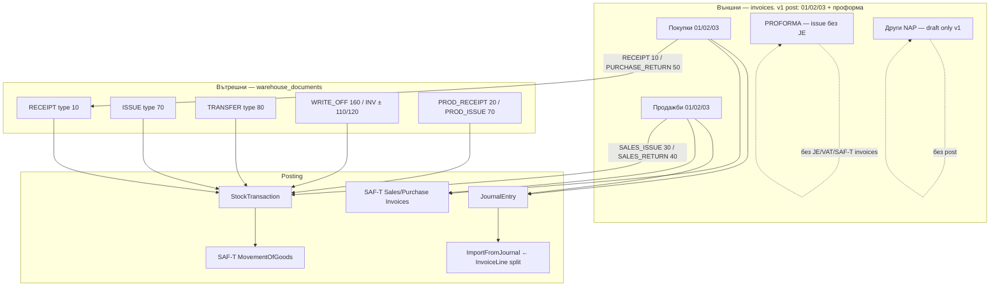
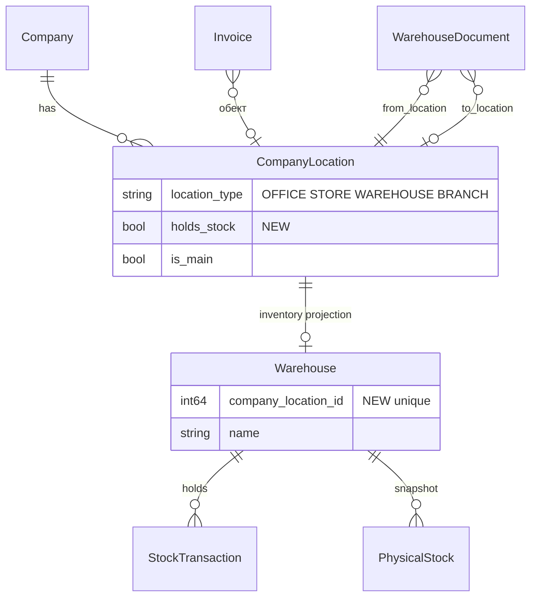
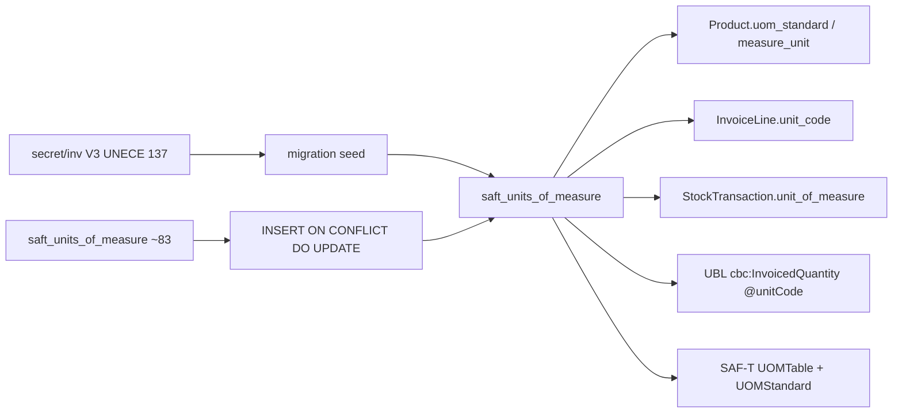
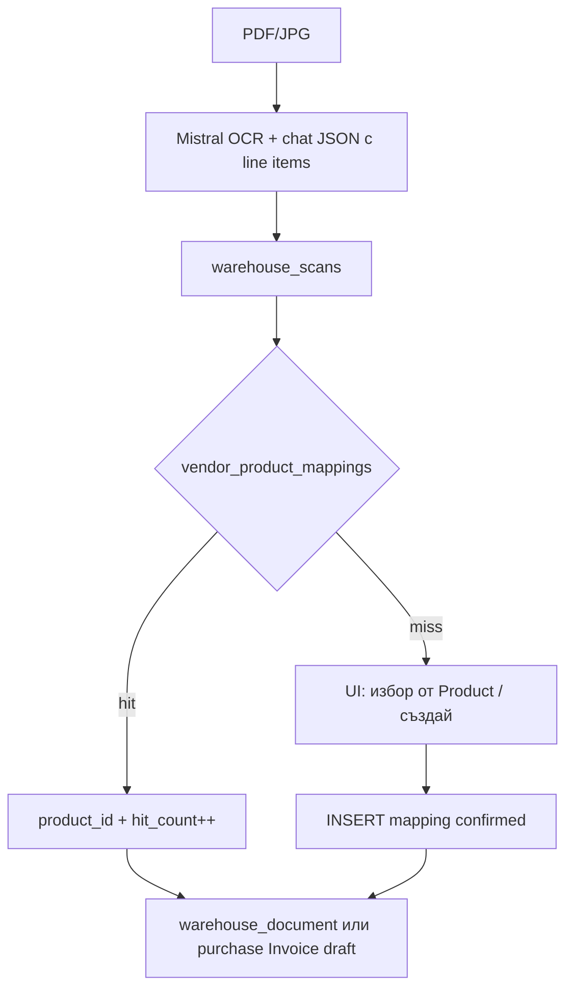

# Складов модул с фактури продажби и покупки (Baraba)

| Поле | Стойност |
|------|----------|
| **Документ** | Design RFC — Warehouse + Sales/Purchase Invoicing |
| **Автор** | Baraba engineering |
| **Дата** | 2026-09-12 |
| **Статус** | **Approved** (rev. 4 + user decisions 2026-09-12) |
| **Аудитория** | Senior engineers, запознати с `backend/` (Lucky/Crystal) и `leptos/` |
| **Референтна система** | `secret/inv/` (Java/React) — стандарти и UX, **не** стек за порт |

---

## Overview

Baraba има счетоводен гръбнак (журнал, ДДС дневници, SAF-T, контрагенти, продукти, OCR за осчетоводяване), но **няма работещ фактурен/складов модул**. Страницата `https://baraba.org/invoices` е статичен stub (`leptos/src/pages/invoices.rs`). Моделът `Invoice` е sales-ish, без посока покупка/продажба, без обект (`CompanyLocation`), без номерационни вериги и с **разминаване модел ↔ схема** (`skip_schema_enforcer`). Складът е разделен на две несвързани понятия (`Warehouse` vs `CompanyLocation`). SAF-T `PurchaseInvoices` е празен stub. Мерните единици са частичен SAF-T seed + hardcoded списък във frontend.

Предложението е да се изгради **складов + фактурен модул** върху съществуващия стек (Lucky + Leptos WASM + PostgreSQL), като от `secret/inv/` се извлекат стандартите (UNECE Rec 20, UNCL1001, EN 16931/VATEX, 10-цифрена номерация, печатна бланка, UX на формата), **без** да се портва Java/React/Jasper/GraphQL.

Архитектурният избор е **два документарни свята с обща номенклатура и общ склад**:

1. **Външни търговски/данъчни документи** — еволюция на таблицата `invoices` (продажби **и** покупки, проформи, известия, протоколи, митнически декларации).
2. **Вътрешни складови документи** — нова таблица `warehouse_documents`, която **не** върти обороти като покупки/продажби и **не** влиза в ДДС дневници.

Обектът върху вътрешните документи идва от **Настройки на фирмата → SAFt → Търговски обекти и локации** (`CompanyLocation`). Складът (`Warehouse`) се унифицира към тези локации чрез FK, вместо да остане паралелна номенклатура.

---

## Background & Motivation

### Защо сега

Счетоводството вече осчетоводява покупки/продажби през:

- ръчен журнал (`JournalEntry` + JSON `lines` / `JournalLine`);
- Controlisy XML импорт (`controlisy_importer.cr`);
- AI сканиране на фактури (`ScannedInvoice` + `MistralDocumentService` + `ScannedInvoiceAccounting`) — **само заглавка + суми**, без редове към `Product`.

Липсва оперативен цикъл „номенклатура → документ → печат/UBL → склад → ГЛ/ДДС/SAF-T“. Без него:

- продажбените фактури не могат да се издават от Baraba с български реквизити (чл. 114/чл. 92 ЗДДС);
- покупките не пълнят SAF-T `PurchaseInvoices` (`docs/SAFT-BG.md`, приоритет 1);
- вътрешните трансфери, ако се осчетоводят като фактури, биха надули обороти и ДДС дневници;
- `Product.measure_unit` / `uom_standard` не са вързани към пълната UNECE номенклатура, нужна за UBL и SAF-T `UOMTable`.

### Текущо състояние (проверено в кода)

#### Frontend

| Път | Файл | Състояние |
|-----|------|-----------|
| `/invoices` | `leptos/src/pages/invoices.rs` | Статична празна таблица; бутонът „+ Нова фактура“ не прави нищо |
| `/products` | `leptos/src/pages/products.rs` | Работещ CRUD; UoM е **hardcoded** `get_units_of_measure()` (15 кода) |
| `/scanned-invoices` | `leptos/src/pages/scanned_invoices.rs` | OCR за осчетоводяване (заглавка) |
| `/warehouse` | — | **Няма** страница, въпреки `docs/architecture.md` и `README.md` |
| Router | `leptos/src/router.rs` | Само `StaticSegment`; няма `:id` routes |
| Nav | `leptos/src/components/layout.rs` | Един линк „Фактури“ |
| Store | `leptos/src/stores/invoice.rs` | Съществува, **не се ползва** от страницата; полетата не съвпадат с API (`total_net_amount` vs `subtotal`) |

#### Backend — Invoice

`backend/src/models/invoice.cr` декларира `document_type` (`INVOICE`/`DEBIT_NOTE`/`CREDIT_NOTE`), `issue_date`, `has_inventory`, `tax_event_date`, `vat_exemption_reason`, `journal_entry_id`, `bank_account_id`, JSON `lines`. Миграцията `backend/db/migrations/20250125000004_create_invoices.cr` създава `invoice_date` (не `issue_date`) и **няма** тези колони. Затова моделът е с `skip_schema_enforcer`. Единствените реални ALTER-и са:

- `20250126000035_add_lines_text_to_invoices.cr` — `lines TEXT DEFAULT '[]'`
- `20250127000006_add_saft_fields_to_invoices.cr` — SAF-T полета (`saft_invoice_type`, `transaction_id`, `saft_customer_id`, …)

Уникален индекс: `(company_id, invoice_number)` — ще се счупи при покупки (номер на доставчика) и при няколко вериги.

Двойно съхранение на редове е **несъществуващ dual-write**, не синхрон: таблица `invoice_lines` се пълни само от `add_line`; JSON `invoices.lines` default `'[]'` и `SaveInvoice.permit_columns` **не включва** `lines`, затова `Create` не записва редове от request-а. `Show` чете `InvoiceLineQuery`. SAF-T `build_invoice` чете `parsed_lines` → за новосъздадени фактури вижда `[]`. Целта е SoT = таблицата, JSON cache да се преизгражда при save на редове.

Няма `direction` (sale/purchase). `generate_saft_ids!` гадае по `counterpart.counterpart_type`. `SaveInvoice` не пипа `invoice_next_number` и `validate_required invoice_number`. `Company.invoice_next_number` е единичен брояч — недостатъчен. `invoice_number` в миграцията е NOT NULL + UNIQUE `(company_id, invoice_number)`.

`ApiAction` изисква JWT (`RequireAuthToken`) и include-ва `Api::Auth::Authorization`, но **никое** от `actions/api/invoices/*.cr` не вика `authorize!(permission, company_id)`. `User#has_permission?(permission, company_id)` проверява ролята във фирмата (super-admin bypass). Без този call всеки автентикиран user с познат `company_id` минава CRUD.

`JournalEntry` също е с `skip_schema_enforcer` (out of scope). PR1 маха skip **само** на `Invoice`.

`PeriodClosedError` (`period_service.cr`) не се хваща в `ApiAction` (само `Unauthorized`/`Forbidden`) — unhandled → 500.

`Api::JournalEntries::Unpost` сетва `status=draft`, **не** `reversed`.

Mistral ключ: `Company#mistral_api_key` → `parsed_settings.dig?("mistral", "api_key")`.

API: `backend/src/actions/api/invoices/{index,show,create,update,delete,add_line}.cr` — CRUD без post/issue/print/UBL. Index не връща `document_type`, `status` филтър има.

#### Склад и локации — две номенклатури

```
CompanyLocation (settings UI, SAF-T Header адрес)
  location_type: OFFICE | STORE | WAREHOUSE | BRANCH
  API: /api/companies/:id/locations

Warehouse (stock FK)
  name, address, is_active
  API: /api/companies/:id/warehouses
  StockTransaction.belongs_to warehouse
  PhysicalStock.belongs_to warehouse
  OpeningBalance.belongs_to warehouse?
```

Няма FK между тях. Вътрешен трансфер днес не може да запише „от обект А към обект Б“ от настройките.

`SaftStockMovementType` код **`80` = Вътрешен трансфер** (`20250127000013_create_saft_nomenclatures.cr`). Код **`302` е сметка материали** в българския сметкоплан, не тип движение — виж `BLOG/saft-двигателят-под-капака.md` (ред „80 │ Вътрешен трансфер │ 302 │ 302“). SAF-T `MovementOfGoods.MovementType` за трансфер е **80**.

`PhysicalStock` е snapshot за OnDemand SAF-T, не live баланс. Няма service, който да преизчислява наличност от `opening_balances` + `stock_transactions`.

Оценка на запасите: `Company.inventory_valuation_method` (`FIFO`/`LIFO`/`WEIGHTED_AVG`) се редактира в настройки, **не се прилага** никъде при изписване.

#### Продукти и мерни единици

`Product` (`backend/src/models/product.cr`): `measure_unit`, `uom_base`, `uom_standard`, `uom_conversion_factor`, `product_type` (10/20/30/40/50), `goods_services_id`, `product_number_code` (EAN), `inventory_account_id`, `revenue_account_id`. `SaveProduct` **не permit-ва** SAF-T UoM полетата. Frontend записва само `measure_unit`.

`SaftUnitOfMeasure` → таблица `saft_units_of_measure` (`code`, `name_en`, `name_bg`). Seed: ~33 основни + ~50 разширени. Липсват `symbol`, `category`. Референсът `secret/inv/.../V3__Full_UNECE_Units_Of_Measure.sql` има **137** единици с `symbol` + `category`.

SAF-T exporter `build_uom_table` е **hardcoded 6 единици** (C62, KGM, LTR, MTR, MTK, HUR), не чете таблицата.

#### ДДС и дневници

Нomenclature-ите за вид документ са **вече кодирани** на две места (трябва да останат един източник):

- `VatJournalEntry::PURCHASE_DOC_TYPES` / `SALES_DOC_TYPES` — `backend/src/models/vat_journal_entry.cr`
- `leptos/src/constants/vat_codes.rs`

Правен източник: `VAT/PPDDS_2025_.html` (поле 02-04 / вид документ). Има леко разминаване в етикетите (напр. код `50`: в кода „Известие за продажба“, в HTML 2025 — протокол за компенсации за гориво). Кодираните константи са работният договор на Baraba; етикетите се сверяват в отделен VAT PR, не блокират склада.

Поток към дневника **днес**: `JournalEntry.vat_purchase_operation` / `vat_sales_operation` (формат `"01|PURCHASE_CREDIT"`) → `Api::VatReturns::ImportFromJournal` → `VatJournalEntry`. Сканираните фактури вече сетват тези полета в `ScannedInvoiceAccounting`. **Не** се пише `VatJournalEntry` директно при осчетоводяване. Това трябва да се запази — иначе двоен импорт.

`SaftInvoiceType` (кодове 1, 2, 3, 7, 9, 11–13, 23, 29, 81, …) е близък до NAP, но **без водеща нула**. Mapping: NAP `"01"` ↔ SAF-T `"1"`.

#### SAF-T SourceDocuments

`backend/src/services/saft_exporter.cr`:

- `build_sales_invoices` — posted `Invoice` с `document_type ∈ {INVOICE, DEBIT_NOTE, CREDIT_NOTE}` (няма филтър по посока);
- `build_purchase_invoices` — **винаги 0 записа**;
- `build_movement_of_goods` — всички `StockTransaction` за периода (OnDemand).

#### OCR

`MistralDocumentService::ScannedInvoiceData` няма line items. Prompt-ът в `docs/MISTRAL_OCR_INTEGRATION.md` иска само заглавка и суми. `ScannedInvoice.has_inventory` не се използва за mapping към `Product`.

#### Референс `secret/inv/` (какво вадим)

| Понятие | Inv | Бележка за Baraba |
|---------|-----|-------------------|
| `Document` + `DocumentItem` | един модел за INVOICE/CREDIT_NOTE/DEBIT_NOTE/PROFORMA | само продажби; ние имаме и покупки + склад |
| `DocumentNumberSequence` + `SequenceType` TAX/NON_TAX | 10 цифри `%010d`, pessimistic lock | твърде бедно — трябват N вериги |
| `UnitOfMeasure` UNECE Rec 20 | 137 реда, symbol, category | seed в `saft_units_of_measure` |
| `DocumentTypeCode` UNCL1001 | 380, 381, 383, … | нова номенклатурна таблица |
| `VatExemptionReason` + VATEX | `ubl_category_code` S/Z/E/K/G/O/AE, `ubl_exemption_code` | нова таблица от V5/V16 |
| `PrintableDocument.jsx` + `invoice_bg.jrxml` | печатна бланка, сума словом | Leptos print, не Jasper |
| `UblExportService` | UBL 2.1 / EN 16931 / Peppol BIS 3.0 XML | порт логиката, не библиотеките |
| `CreateInvoiceNew.jsx` | UX: тип, номер, дати, клиент, редове, ДДС per line, VATEX | шаблон за Leptos форма |

`secret/inv` **Document** е търговски документ. Baraba `Document` (`backend/src/models/document.cr`) е **прикачен файл** (`file_url`, `status: pending/processed/archived`). **Не се преизползва.**

---

## Goals & Non-Goals

### Goals (v1)

1. Работещи **фактури продажби** NAP `01/02/03` + проформа (`INVOICE`/`DEBIT_NOTE`/`CREDIT_NOTE`/`PROFORMA`) с български реквизити, 10-цифрен номер, печатна бланка, осчетоводяване в ГЛ + ДДС дневник, **включително смесени ставки и кредитни известия със знак**.
2. Работещи **фактури покупки** NAP `01/02/03` (ръчно + опционално от складово AI сканиране), които пълнят SAF-T `PurchaseInvoices` и ДДС дневник покупки. Други NAP кодове (07, 09, 11–13, 81–85, …) се записват като draft **без** `InvoicePoster.post` в v1.
3. **Вътрешни складови документи** (приход, разход, трансфер между `CompanyLocation`, брак, инвентаризация) → `StockTransaction` + SAF-T movement type; **без** `vat_*_operation`, **без** приход/разход в ОПР.
4. Една таблица мерни единици, съвместима с UBL (UNECE Rec 20) и SAF-T Nom; продуктите ползват тези кодове.
5. Номерация: няколко вериги на фирма, групиране на типове, 10 цифри с водещи нули, gapless за издадени данъчни документи.
6. AI складово сканиране **отделно** от `/scanned-invoices`, с запомняне vendor article → `product_id`.
7. UI: `/invoices` става хъб (продажби / покупки / склад), без да се чупи журнал, ДДС, банки, Controlisy, scanned-invoices.
8. UBL 2.1 XML export за издадени продажбени данъчни документи (данни + файл). PEPPOL мрежа — не в v1.

### Non-Goals (v1)

- Порт на Java/React/GraphQL/Jasper/Mongo от `secret/inv`.
- PEPPOL AP (AS4), електронен подпис, Peppol directory.
- Партиди/серийни номера като първокласен UI (колоната `stock_account_no` остава за SAF-T, без UI).
- Пълен FIFO слой по партиди; v1 = среднопретеглена или цена от документа (виж Key Decisions).
- Производствен MRP / калкулация себестойност (само складови документи 20/70 ако има нужда).
- Фискални устройства / Наредба Н-18 бонове (B2C каса).
- Сървърен PDF renderer (wkhtmltopdf/Chromium). v1 = Leptos print view + `window.print`, както `reports.rs`.
- Автоматично създаване на Baraba `Invoice` от Controlisy XML (Controlisy остава GL-first).
- Сливане на `/scanned-invoices` в склада.
- Преименуване на таблицата `invoices` → `documents` (конфликт с file `documents`).
- Промяна на паричния тип `Float64` → `Numeric` в целия ГЛ (out of scope). В модула: `Money.round` = half-up към 2 знака, не `Float64#round` (banker's).
- Posting на протоколи 09, митница 07, касова 11–13, отчети 81–85 (UI draft only).
- Tax-inclusive цени в редовете (само без-ДДС математика, като inv `DocumentItem.calculateAmounts`).

---

## Key Decisions

| # | Решение | Рационал |
|---|---------|----------|
| KD1 | **Два документарни агрегата**: еволюция на `invoices` (външни) + нова `warehouse_documents` (вътрешни). Не един mega-`Document`. | Различни posting pipelines, номерация, контрагент (задължителен vs опционален), ДДС. Съществуващият `Document` е файл. Един полиморфен модел рискува вътрешен трансфер да влезе в `build_sales_invoices` / VAT import. |
| KD2 | **Не преименуваме** `invoices`. Добавяме `direction` (`sale`/`purchase`). | `PaymentLine.belongs_to invoice`, SAF-T exporter, serializers вече са вързани. Rename е механичен PR без продуктова стойност. |
| KD3 | **`Warehouse` се вързва 1:1 към `CompanyLocation`** чрез `warehouses.company_location_id` (unique). Обект на документ = `CompanyLocation`. Stock FK остава `warehouse_id` (стабилност на `StockTransaction`/`PhysicalStock`/`OpeningBalance`). | User: обектът е от SAFt настройки. Паралелни номенклатури гарантират разминаване. Не drop-ваме `warehouses` в v1 заради съществуващи FK. |
| KD4 | Вътрешен трансфер: SAF-T movement type **`80`**, не 302. ГЛ само ако аналитичните складови сметки се различават; **никога** `vat_purchase_operation` / `vat_sales_operation`. | 302 е сметка. Дневникът се пълни само от тези две JE полета (`import_from_journal.cr`). |
| KD5 | **Една UoM таблица**: разширяваме `saft_units_of_measure` (не създаваме `units_of_measure`). Seed от inv V3. `Product.uom_standard` / `measure_unit` = `code`. | Вече се ползва от модела `SaftUnitOfMeasure` и SAF-T docs. Втора таблица = dual source of truth. |
| KD6 | Номерация: `document_number_sequences` (N вериги/фирма) + `document_sequence_bindings` (един ред на тип, няколко типа → една верига). Формат `%010d`. **Алокация при issue**. Draft: `invoice_number IS NULL` (колоната става nullable в PR1). Preview е display-only и **не се persist-ва**. Данъчни вериги: cancelled пази номера. | NOT NULL + UNIQUE `(company_id, invoice_number)` блокира два draft-а и allocate-at-issue. Inv `generateNextNumber` прави дупки. PostgreSQL UNIQUE допуска много NULL. |
| KD7 | Покупките **не** харчат наши вериги. Номерът на доставчика се пази **пълен** в `invoices.invoice_number`. Truncate до 20 символа само при запис в `JournalEntry.document_number` / `VatJournalEntry.document_number`. Unique: `(company_id, counterpart_id, invoice_number, issue_date) WHERE direction='purchase' AND status IN ('issued','posted')` — **без** draft и cancelled. | Старият unique е грешен за покупки. Включването на cancelled блокира коректно повторно въвеждане. |
| KD8 | **SoT за редове = `invoice_lines`**. JSON `invoices.lines` се преизгражда при save на редовете (временен cache за SAF-T). Днес Create **не** пише нито JSON редове, нито таблица. | Show чете таблицата; SAF-T чете празен JSON. |
| KD9 | Posting създава **един** `JournalEntry` на документ, **не** пише `VatJournalEntry`. Смесени ставки: `ImportFromJournal` ако има `Invoice` по `journal_entry_id`, разпределя колоните от `InvoiceLine` (ставка + VATEX). Иначе остава Controlisy етикетът. `vat_*_operation` = `"{nap}|FROM_INVOICE"` за posted Invoice. | Един етикет `01|DOMESTIC_SALE` не може да запълни едновременно 20%/9%/0% колони. |
| KD10 | AI склад ≠ `/scanned-invoices`. Нов ресурс + таблица `vendor_product_mappings`. | Съществуващият OCR е за ГЛ (401/411 + ДДС), без артикули. Смесването ще счупи осчетоводяването. |
| KD11 | Печат v1 = Leptos `/invoices/:id/print` + CSS `@media print` (pattern от `leptos/src/pages/reports.rs`). Не Jasper, не сървърен PDF. | Baraba вече печата отчети така. Jasper е Java стек. |
| KD12 | UBL XML export v1 за **продажбени** данъчни документи. PEPPOL изпращане — v2. | Данните (VATEX, UNCL1001, UNECE) се слагат в v1, за да не се мигрира после. Мрежата е отделен интеграционен проект. |
| KD13 | Оценка v1: **moving average**, persistната в `stock_balances (company_id, product_id, warehouse_id)` — `qty`, `avg_cost`, обновявана в същата транзакция като `StockTransaction`. Default на фирма: `WEIGHTED_AVG` (миграция + UI). FIFO = warning „в тази версия се прилага средна“. LIFO = не се предлага на нови фирми. | Няма колона за avg. Replay без lock е race. `Company.inventory_valuation_method` default днес е `FIFO`. |
| KD14 | PR1 = schema reconciliation + `direction` + **nullable `invoice_number`** + drop на стария unique + `direction=sale` филтър в `build_sales_invoices`. Без `sequence_id`/`location_id` (няма още таблици). Без UI. | `skip_schema_enforcer` е опасен. §5.1 и PR план трябва да съвпадат. |
| KD15 | Router: `/invoices` хъб; **static сегменти преди** `ParamSegment(:id)`. `/scanned-invoices` не се пипа. | Иначе `purchases`/`new` се хващат като id. |
| KD16 | **`InvoicePoster` никога не INSERT-ва `StockTransaction`.** Всяко qty минава през `warehouse_documents` (`invoice_id` unique = един WD **на този** документ). Продажба → `SALES_ISSUE` (**30**). Продажбен КИ → `SALES_RETURN` (**40**). Покупка → `RECEIPT` (**10**). Покупков КИ → **нов** системен `PURCHASE_RETURN` (`invoice_id` = КИ, `original_warehouse_document_id` → RECEIPT, movement **50**). **Няма** `credit_note_invoice_id` на RECEIPT. Два частични КИ = два WD; unpost на първия оставя втория. Unpost на фактура unpost-ва **нейния** WD. `apply` 422 ако вече има WD за същия `invoice_id`. | Един FK на RECEIPT не държи два КИ; reverse на същия WD при unpost би изтрил чужди type-50 редове. |
| KD17 | Кредитни известия: `InvoiceLine.line_total` / `vat_amount` / header totals са **отрицателни**. JE header `total_amount`/`total_vat_amount` = същите знаци. ГЛ редове са с обратни страни и **положителни** суми. `ImportFromJournal` за Invoice ползва signed line totals, не `VatAmounts` (който прави `.abs` по 453*). Дебитно = положително доначисляване. | Reverse-side JE с положителни totals влиза в дневника като нова продажба. |
| KD18 | v1 `InvoicePoster.post` само за `document_type ∈ {INVOICE, DEBIT_NOTE, CREDIT_NOTE}` и `nap_document_type ∈ {01,02,03}`. `PROFORMA` = issue без JE. Останалите NAP = draft, бутонът post връща 422. | Иначе poster-ът е неимплементируем (09/07/11–13/81–85, counterpart required, касова отчетност). |
| KD19 | Редовете са **без ДДС** (`unit_price` net). Няма tax-inclusive toggle в v1. | Съвпада с inv `calculateAmounts`. |
| KD20 | FX: функционална валута = `Company.currency`. JE и stock `unit_price`/`book_value` са във функционалната. `Invoice` пази оригинал (`currency`, `exchange_rate`, суми в оригинал). Конверсия: `func = Money.round(orig * exchange_rate)` (BGN/EUR = 1.95583 когато едната е BGN). Няма 624/724 в v1 (едноредов курс, не валутна преоценка). Default `invoices.currency` = `company.currency`, не hardcoded BGN. | Моделът default BGN, фирмата често EUR. |
| KD21 | Инвентарен ред: `product_id` present **и** `goods_services_id != "02"` **и** `product_type ∈ {10,20,30,40}` **и** `inventory_account_id` present. Тип `50` и услуги (`02`) не движат склад. UI `"S"` се маха; услуги = `goods_services_id=02`, `product_type` nil. `has_inventory` default true ако има ≥1 такъв ред. | `SaveProduct` reject-ва `"S"`; SAF-T услуга е `goods_services_id`. |
| KD22 | Пари: `Money.round(x)` = half-up към 2 знака (като inv `RoundingMode.HALF_UP`). Забранено е `Float64#round` в poster/lines (banker's). Spec с 0.1+0.2 и 1.005. | Crystal `round` ≠ търговско закръгляне. |
| KD23 | `counterpart_id` **required** за v1 posting типове (01/02/03). Nullable само за бъдещи 81–85/някои 09 — които v1 не постят. Counterpart.eik на продажба **не може** да е `Company.eik` (забрана self-sale; трансфер = warehouse TRANSFER). | Иначе вътрешно движение като фактура надува обороти. |
| KD24 | Отрицателна наличност: default забранена. Bypass само ако **и двете**: `company.settings.allow_negative_stock=true` **и** permission `WAREHOUSE_POST`. | Не setting XOR permission. |
| KD25 | Всеки **нов** API action вика `authorize!(perm, company_id.to_i64)` в същия PR. `INVOICE_ISSUE`/`INVOICE_CANCEL` влизат в `Permission::INVOICE_ALL` и `ALL_PERMISSIONS`; `WAREHOUSE_*` в `ALL_PERMISSIONS`. Migration append-ва JSON на съществуващи `roles.permissions`: accountant ← ISSUE+CANCEL+WAREHOUSE_*; viewer/`READ_ONLY` ← `WAREHOUSE_READ`. Admin ролята **няма** `INVOICE_ALL` днес (`reference_data.cr`) — не ѝ ги добавяме (счетоводителят фактурира). Flag `warehouse_module_enabled?` **не** гейтва `GET /api/nomenclatures/*`. | `roles.permissions` е замразен JSON, не live константа. Accountant иначе 403 след PR8. |
| KD26 | Unpost: JE → `reversed` **и** `vat_*=nil`; свързаният WD (по `invoice_id`) се unpost-ва заедно; фактура → `issued`; re-post = нов JE. `ImportFromJournal` **изключва само** `status=="reversed"` (и/или празни `vat_*`). **Не** изисква `posted` — Controlisy и scan създават **draft** JE (`controlisy_importer.cr`, `import_from_journal_spec.cr`). FROM_INVOICE само ако `Invoice.status=="posted"`. Controlisy остава draft (§14 без промяна). Нови scan JE могат да са posted; съществуващите draft продължават да се импортират. Spec: posted Invoice 01 → unpost → FROM_INVOICE 0 за този документ; Controlisy draft редовете в същия период остават. | `status=posted` филтърът трие Controlisy VJE при rebuild (import delete-all + recreate). vat_*=nil на reversed стига. |
| KD27 | SAF-T `TaxCode` на линия = код от `saft_tax_codes`, **не** `VatRate.saft_tax_code` (`NOR`/`RED`/`ISE`/`NS` в `seeds.cr`). Map: 20%→`100211`, 9%→`100213`, VATEX K→`100215`, G→`100214`, E→`100219`, друг 0%→`100214`. `100212`/`100220` (ВОП) не са v1 posting. JSON cache ползва същия map. | `build_tax_table` вече емитва 100211/100213/…; NOR в SourceDocuments чупи такс таблицата. |
| KD28 | `warehouse_documents.document_number` nullable на draft; allocate `%010d` при **post** от `WH_INTERNAL` (`Query#for_update`). Unique `(company_id, sequence_id, document_number) WHERE status IN ('posted','cancelled')`. | Същият draft-номер капан като при фактурите. |

---

## Proposed Design

### 1. Документарна вселена



#### Класификация на външен документ

| Поле | Роля |
|------|------|
| `direction` | `sale` / `purchase` — първокласно, **не** се извежда от контрагента |
| `document_type` | Оперативен тип v1: `INVOICE`, `DEBIT_NOTE`, `CREDIT_NOTE`, `PROFORMA`. Други (`PROTOCOL`, `CUSTOMS`, `SALES_REPORT`) — persist като draft, без post. |
| `nap_document_type` | 2-символен НАП код. v1 post: `01`/`02`/`03`. NULL за проформа |
| `saft_invoice_type` | вече съществува; синхронизира се от `nap_document_type` (`01`→`1`) |
| `uncl1001_code` | UBL `cbc:InvoiceTypeCode` (380/381/383/…). NULL ако не е UBL-документ |
| `is_tax_document` | derived: `nap_document_type` IS NOT NULL **и** `document_type != PROFORMA` |

Проформа: `direction=sale`, `document_type=PROFORMA`, `nap_document_type=NULL`, issue (номер от `PROFORMA` верига), без JE, може да се конвертира до фактура (новата фактура `original_invoice_id` → проформата).

Кредитно/дебитно: задължителен `original_invoice_id` към фактура в същия `direction` и `company_id`. Не може КИ към проформа.

**Забрани против фалшив оборот (валидация в SaveInvoice / poster):**

- `document_type` ∈ warehouse types е невалидно на `invoices` (422).
- TRANSFER/RECEIPT/ISSUE се създават само като `warehouse_documents`.
- Продажба: `counterpart.eik` (нормализиран) ≠ `company.eik`; същото за `vat_number`.
- Покупка към собствената фирма = 422 (ползвай TRANSFER).

#### Вътрешни типове — отделна таблица `warehouse_document_types`

Глобален seed (не per-company):

| code | name_bg | saft_movement_type | needs_from | needs_to | default_is_incoming |
|------|---------|--------------------|------------|----------|---------------------|
| `RECEIPT` | Складова разписка / приход | **`10`** | не | да | true |
| `SALES_ISSUE` | Продажба (системно, скрит в UI) | **`30`** | да | не | false |
| `SALES_RETURN` | Връщане от клиент (системно) | **`40`** | не | да | true |
| `PURCHASE_RETURN` | Връщане към доставчик (системно) | **`50`** | да | не | false |
| `ISSUE` | Вътрешен разход (не продажба) | **`70`** | да | не | false |
| `TRANSFER` | Вътрешен трансфер | **`80`** | да | да | n/a (две движения) |
| `WRITE_OFF` | Брак | **`160`** | да | не | false |
| `INV_PLUS` | Инвентаризация — излишък | **`110`** | не | да | true |
| `INV_MINUS` | Инвентаризация — липса | **`120`** | да | не | false |
| `PROD_RECEIPT` | Произведена продукция | **`20`** | не | да | true |
| `PROD_ISSUE` | Влагане в производство | **`70`** | да | не | false |
| `EXPIRY` | Изтекъл срок | **`170`** | да | не | false |
| `OTHER` | Друго движение | **`180`** | опц. | опц. | param |

Потребителският `ISSUE` **не** е продажба. Продажба+стоки = `SALES_ISSUE` (30). КИ продажба = `SALES_RETURN` (40). КИ покупка = `PURCHASE_RETURN` (50) с `original_warehouse_document_id` към RECEIPT. Системните типове не са в dropdown „Нов складов документ“.

Ръчен `RECEIPT` без свързана покупна фактура е позволен (начални наличности, безвъзмездно получаване, корекции) — **не** пълни POKUPKI. Това е процесен избор, не бъг. UI warning: „Този приход не създава запис в дневник покупки“.

Правило против обороти:

```
warehouse_documents.status = posted
  → StockTransaction(s)
  → JournalEntry: TRANSFER **никога** (`post_gl_on_transfer=false`); WRITE_OFF/INV_* могат да имат балансов/разходен JE без vat_*
  → JournalEntry.vat_purchase_operation = nil
  → JournalEntry.vat_sales_operation = nil
  → не влиза в SalesInvoices / PurchaseInvoices
  → MovementOfGoods.MovementType = warehouse_document_types.saft_movement_type
```

„Не въртят обороти“ = няма обороти по 70x/60x и няма редове в POKUPKI/PRODAJBI. Обороти по 302/304 (баланс) са допустими и очаквани за SAF-T.

### 2. Обект / локация / склад



**Правила**

1. Добавяме `company_locations.holds_stock : Bool` (default `true` за `WAREHOUSE`/`STORE`, `false` за `OFFICE`). `BRANCH` — ръчно.
2. При `holds_stock=true` гарантираме `Warehouse` ред (trigger-like в operation `SaveCompanyLocation`, не DB trigger).
3. `warehouses.company_location_id` UNIQUE, NOT NULL след backfill.
4. UI: складовете **не** се редактират отделно. `SaveCompanyLocation` с `holds_stock=true` ensure-ва `Warehouse`. `POST/PUT /api/companies/:id/warehouses` след backfill връща **410** („ползвайте /locations“). `POST .../stock_transactions` връща **403** освен ако `warehouse_module` debug (не се ползва от UI; движенията минават през документи).
5. На `Invoice`: `location_id` → `CompanyLocation`. Default = първият `holds_stock=true` (не `is_main` — той обикновено е OFFICE). Ако има KD21 ред: `location_id` **задължителен** и локацията трябва `holds_stock=true` (иначе 422; няма `Warehouse` за `StockTransaction.warehouse_id`).
6. На `WarehouseDocument`: `from_location_id` / `to_location_id`. TRANSFER — различни локации, и двете `holds_stock`.
7. `StockTransaction.warehouse_id` се резолва: `CompanyLocation` → `Warehouse`.
8. `PhysicalStock.location_id` (свободен String) се пълни с `company_locations.saft_location_code` (ново поле, default `id.to_s`) за SAF-T `LocationID`.
9. `Invoice.branch_store_number` = `CompanyLocation.branch_code` (ново, nullable). Default: `Company.vat_branch_number` форматиран 4 цифри, иначе `"0001"`. **Не** ползваме location id като NAP клон.

**Миграция на данни (1:1 е принудителна; няма merge UX в v1)**

- Всеки съществуващ `Warehouse` → нова `CompanyLocation(WAREHOUSE, name=warehouse.name, holds_stock=true)` + `warehouse.company_location_id`. Два склада с подобни имена остават два обекта.
- Всяка `CompanyLocation` тип WAREHOUSE/STORE без warehouse → INSERT `Warehouse`.
- След backfill: `company_location_id NOT NULL UNIQUE`.
- `warehouses.name/address` остават cache, sync от локацията.

### 3. Унификация на мерни единици



**Схема** (`ALTER saft_units_of_measure`)

| Колона | Тип | Бележка |
|--------|-----|---------|
| `code` | VARCHAR(10) PK logical unique | вече UNIQUE |
| `name_bg` | VARCHAR | rename semantic от inv `name` |
| `name_en` | VARCHAR | вече има |
| `symbol` | VARCHAR(32) **NEW** | бр., кг, м² |
| `category` | VARCHAR(32) **NEW** | UNIT, MASS, LENGTH, AREA, VOLUME, TIME, PACKAGING, ELECTRICAL, … |
| `is_common` | BOOL default false **NEW** | топ единици за dropdown |
| `sort_order` | INT **NEW** | |

Seed: INSERT от V3 **преди** да се маркира `is_common` (`EA` го няма в текущия SAF-T seed; идва с V3). `is_common=true` за C62, EA, PCE, SET, PR, KGM, GRM, TNE, LTR, MTR, CMT, MTK, MTQ, HUR, DAY, MON, ANN, KWH, PK, BX.

`PCE`, `H87` и `C62` са различни UNECE кодове — **не** ги сливаме. UI default за брой = `C62`.

**Продукт**

- `measure_unit` остава (taxpayer UOM, често = standard).
- `uom_standard` NOT NULL default `C62` след backfill; валидация в `SaveProduct` към `saft_units_of_measure.code`.
- `uom_base` = measure_unit ако е същата единица.
- `SaveProduct` permit-ва `uom_standard`, `uom_base`, `uom_conversion_factor`, `goods_services_id`, `product_number_code`, `valuation_method`. `product_type` остава `10/20/30/40/50` или nil; **махваме** UI опция `"S"`. Услуга: `goods_services_id="02"`, `product_type=nil`.
- Frontend `get_units_of_measure()` и `get_product_types()` `"S"` се **изтриват**; UoM от `GET /api/nomenclatures/units_of_measure?common=true`.

**SAF-T** `build_uom_table`: DISTINCT кодове, използвани от продукти + движения в периода, union common set. Не hardcoded 6.

### 4. Номерация

```mermaid
sequenceDiagram
  participant UI
  participant API
  participant Seq as document_number_sequences
  participant Inv as invoices

  UI->>API: GET .../sequences/:id/preview
  API->>Seq: current_number+1 (read)
  API-->>UI: "0000000042" (не се заключва)

  UI->>API: POST .../invoices/:id/issue
  Note over UI: preview полето е disabled; не се праща в body
  API->>Seq: AppDatabase.transaction + Query#for_update
  Seq-->>API: next = current+1
  API->>Inv: invoice_number = sprintf("%010d", next), status=issued
  API->>Seq: current_number = next
  Note over API,Inv: draft държи invoice_number NULL; cancelled пази номера
```

**Таблици**

`document_number_sequences`

| Колона | Тип | |
|--------|-----|---|
| `company_id` | FK | |
| `code` | String | уникален per company: `SALES_TAX`, `PROFORMA`, `PROTOCOLS`, `WH_TRANSFER`, … |
| `name` | String | „Данъчни продажби“ |
| `current_number` | Int64 | последно **отдаден** номер |
| `padding` | Int32 | default 10 |
| `is_tax` | Bool | gapless policy |
| `reset_policy` | String | **`never`** (заключено 2026-09-12; без auto-reset) |

Unique `(company_id, code)`.

`document_sequence_bindings`

| Колона | |
|--------|---|
| `company_id` | |
| `family` | `invoice_sale` / `invoice_purchase` / `warehouse` |
| `document_type` | `INVOICE`, `CREDIT_NOTE`, `TRANSFER`, … |
| `sequence_id` | FK |

Unique `(company_id, family, document_type)` — **един ред на тип**. Споделена верига = няколко реда с един и същ `sequence_id` (три реда за `INVOICE`/`DEBIT_NOTE`/`CREDIT_NOTE` → `SALES_TAX`).

**Default seed при нова фирма** (метод `DocumentNumberService.initialize_for_company(company_id)`, викан до `CompanyAccountsInitializer`, **не** вътре в него):

| sequence.code | is_tax | binding редове (family, document_type) |
|---------------|--------|----------------------------------------|
| `SALES_TAX` | true | (`invoice_sale`,`INVOICE`), (`invoice_sale`,`DEBIT_NOTE`), (`invoice_sale`,`CREDIT_NOTE`) |
| `PROFORMA` | false | (`invoice_sale`,`PROFORMA`) |
| `PROTOCOLS` | true | (`invoice_sale`,`PROTOCOL`), (`invoice_sale`,`SALES_REPORT`) — v1 без post |
| `WH_INTERNAL` | false | по един ред за всеки warehouse type (`warehouse`,`RECEIPT`), … |

Покупките нямат binding (KD7). `invoice_purchase` family е резервирана, празна в seed.

`Company.invoice_next_number`: backfill `SALES_TAX.current_number = max(invoice_next_number-1, 0)`. Колоната остава до cleanup PR.

**Заключване:** в `AppDatabase.transaction`:

```crystal
seq = DocumentNumberSequenceQuery.new.id(sequence_id).for_update.first
# Avram Query#for_update → SELECT … FOR UPDATE (виж lib/avram/src/avram/queryable.cr)
```

Lock timeout / deadlock → 409 `{success:false, error:"number_lock_timeout"}`. Клиентът retry-ва issue веднъж след 200ms. Без `SKIP LOCKED` (би пропуснал веригата). `current_number + 1 >= 10_000_000_000` → 422.

**Draft номер**

- `invoices.invoice_number` **nullable** от PR1.
- Draft: винаги `NULL`. UI preview (`GET .../preview`) е disabled input, не е в POST body.
- `SaveInvoice`: `validate_required invoice_number` **само** ако `status != "draft"` (продажба). Покупка: номерът може да се пише в draft, unique важи от PR7 само за issued/posted.
- DELETE: само `status=draft` (PR1 guard). Issued/posted/cancelled → 422.

**Дупки (BG практика)**

- Издаден данъчен номер **не се рециклира**. Cancel = `cancelled` + причина; номерът остава в unique индекса за продажби.
- Корекция = КИ/ДИ със **собствен** следващ номер.
- Ръчен override на продажбен номер: `is_tax=false` или super-admin + `INVOICE_ISSUE` + audit. Данъчна верига след първо issue — само set на `current_number` преди първи документ.
- Годишен рестарт: **`reset_policy=never`** (Решено, user 2026-09-12). Ръчен set на `current_number` с audit преди първи документ за годината. Без auto-reset.

**Покупки:** `invoice_number` = пълният номер на доставчика (без pad, без truncate в таблицата). При JE/NAP: `document_number = invoice_number[0, 20]`. Draft покупка може да има временен номер (потребителят го пише) — unique **не** важи за draft; при issue/post се проверява уникалността.

### 5. Модел на данни — външен документ

#### 5.1 Колони на `invoices` — собственост по PR

`skip_schema_enforcer` се маха в **PR1**, след като PR1 колоните съществуват. Не се добавят FK към таблици, които още ги няма.

| Колона | PR | Действие |
|--------|----|----------|
| `invoice_date` → `issue_date` | **1** | rename ако колоната още е `invoice_date` |
| `document_type` | **1** | ADD default `INVOICE` |
| `direction` | **1** | ADD `sale`/`purchase`, default `sale`; **същият PR** филтрира `build_sales_invoices` с `direction=sale` (merge blocker) |
| `original_invoice_id` | **1** | ADD nullable FK invoices |
| `exchange_rate` | **1** | ADD default 1.0 |
| `payment_method` | **1** | ADD nullable |
| `tax_event_date` | **1** | ADD nullable |
| `vat_exemption_reason` | **1** | ADD nullable text (legacy) |
| `has_inventory` | **1** | ADD default false |
| `journal_entry_id` | **1** | ADD nullable FK journal_entries |
| `bank_account_id` | **1** | ADD nullable FK bank_accounts |
| `invoice_number` | **1** | ALTER **nullable**; DROP UNIQUE `(company_id, invoice_number)`; ADD UNIQUE `(company_id, invoice_number) WHERE invoice_number IS NOT NULL AND direction = 'sale'` (много draft NULL са OK; покупки без unique до PR7) |
| `currency` default | **1** | не се сменя схемата; Create сетва `company.currency` |
| `vat_exemption_reason_id` | **4+6** | FK след seed на `vat_exemption_reasons` |
| `sequence_id` | **5** | FK `document_number_sequences` (таблицата е PR5) |
| `location_id` | **7** | FK `company_locations` (връзката warehouse е PR3; колоната на invoice е PR7) |
| `nap_document_type` | **7** | String(2) nullable |
| `uncl1001_code` | **7** | String(10) nullable |
| `status` + `issued` | **7** | allowed: `draft`, `issued`, `posted`, `cancelled` |
| `issued_at`, `cancelled_at`, `cancellation_reason` | **7** | |
| sales unique към sequence | **7** | DROP PR1 unique; UNIQUE `(company_id, sequence_id, invoice_number) WHERE sequence_id IS NOT NULL AND status IN ('issued','posted','cancelled')` |
| purchase unique | **7** | UNIQUE `(company_id, counterpart_id, invoice_number, issue_date) WHERE direction='purchase' AND status IN ('issued','posted')` |
| INDEX `(company_id, direction, issue_date)` | **7** | |

`due_date` вече съществува.

Статуси след PR7:

```
draft → issued → posted
              ↘ cancelled
issued → cancelled
posted → unpost (отворен период) → issued  |  или КИ/ДИ; номерът остава
```

- Draft: `invoice_number` NULL (продажба) или свободен текст (покупка, още не unique).
- `issued`: номер зает. Проформа спира тук.
- `posted`: има `journal_entry_id`. UI default: **„Издай и осчетоводи“** (`issue_and_post`). Разделени issue/post остават в API за права (`INVOICE_ISSUE` без `ACCOUNTING_POST`).

#### 5.2 `invoice_lines` — пълни редове

| Колона | |
|--------|---|
| вече: `description`, `quantity`, `unit_price`, `vat_rate`, `line_total`, `account_id` | |
| `product_id` | nullable FK — услуги без номенклатура са позволени |
| `unit_code` | UNECE, default от продукта или C62 |
| `vat_amount` | round 2 |
| `line_total_with_vat` | |
| `vat_exemption_reason_id` | задължителен ако `vat_rate==0` и документът е данъчен |
| `line_number` | 1-based |
| `tax_type` / `tax_code` | SAF-T Nom код (KD27 map, не `VatRate.saft_tax_code`) |
| `discount_percent` / `discount_amount` | v1: само line-level |

Изчисление — **net unit_price**, half-up (`Money.round`, KD22). За `CREDIT_NOTE` sign = −1, иначе +1:

```
line_total           = sign * Money.round(quantity * unit_price)
vat_amount           = sign * Money.round(abs(line_total) * vat_rate / 100)
line_total_with_vat  = line_total + vat_amount
```

`vat_exemption_reason_id` задължителен ако данъчен документ и `vat_rate==0`. Header totals = sum на редовете (ще са отрицателни за КИ). Без ръчен override. Header отстъпка v1 няма; само line-level.

`invoices.lines` JSON се пише от serializer след save на редовете, формат съвместим с `saft_exporter.build_invoice`:

```json
[{
  "product_code": "...",
  "description": "...",
  "quantity": 1.0,
  "unit": "C62",
  "unit_price": 10.00,
  "vat_rate": 20.0,
  "subtotal": 10.00,
  "vat_amount": 2.00,
  "total": 10.00,
  "tax_code": "100211"
}]
```

`tax_code` се пише **на линия** по KD27 (ред 9% → `100213`, ВОД K → `100215`), не hardcoded 100211 за всички.

#### 5.3 Номенклатурни таблици

`vat_exemption_reasons` — seed от `secret/inv/.../V5__VAT_Exemption_UBL_Codes_And_Client_Country.sql` + V16. Колони: `reason_code`, `reason_name`, `reason_name_en`, `legal_basis`, `legal_basis_en`, `ubl_category_code`, `ubl_exemption_code`, `is_active`, `sort_order`. Глобална таблица.

`document_type_codes` — UNCL1001 seed от V4. Глобална.

`nap_document_types` — опционална DB проекция на константите (за UI без recompile). v1 може да остане Crystal/Rust constants; препоръка: таблица `nap_document_types(code, journal, name_bg, saft_invoice_type, is_tax)` за да не държим трето копие. Leptos чете API, `vat_codes.rs` остава fallback.

`warehouse_document_types` — seed по-горе.

### 6. Модел — вътрешен складов документ

`warehouse_documents`

| Колона | |
|--------|---|
| `company_id` | |
| `document_type` | code от `warehouse_document_types` |
| `document_number` | nullable на draft; `%010d` при post (KD28) |
| `sequence_id` | FK `WH_INTERNAL` |
| `issue_date` | |
| `status` | draft/posted/cancelled |
| `from_location_id` | FK CompanyLocation |
| `to_location_id` | |
| `notes` | |
| `journal_entry_id` | nullable |
| `source_id` | user/module |
| `movement_type` | denorm SAF-T code |
| `invoice_id` | nullable unique FK — този търговски документ (покупка, КИ, продажба); втори WD за същия id = 422 |
| `original_warehouse_document_id` | nullable FK към RECEIPT — само за `PURCHASE_RETURN` |

`warehouse_document_lines`

| Колона | |
|--------|---|
| `product_id` | required |
| `quantity` | > 0 |
| `unit_code` | |
| `unit_price` | себестойност |
| `line_total` | |
| `line_number` | |

Unique: `(company_id, sequence_id, document_number) WHERE status IN ('posted','cancelled')`. Draft: `document_number` NULL (KD28). Allocate в `WarehouseDocumentPoster.post`.

TRANSFER posting създава **два** `StockTransaction` реда на линия (outgoing from + incoming to) с един и същ **вече алокиран** `document_number`, `movement_type=80`, `is_incoming` false/true. `unit_price` = текуща средна на from-склада (не продажна цена).

### 7. Posting към ГЛ, ДДС, SAF-T, склад

**Gate (KD18):** `post` / `issue_and_post` 422 освен ако `document_type ∈ {INVOICE, DEBIT_NOTE, CREDIT_NOTE}` и `nap_document_type ∈ {01,02,03}`. Проформа: само `issue`. `PeriodClosedError` → 422 (PR8). Flag `warehouse_module_enabled?` 404-ва poster/warehouse-docs/scan UI — **не** nomenclature GET.

```mermaid
sequenceDiagram
  participant User
  participant Poster as InvoicePoster
  participant Period as PeriodService
  participant Seq as DocumentNumberService
  participant JE as SaveJournalEntry
  participant WH as WarehouseDocumentPoster
  participant Inv as Invoice

  User->>Poster: issue_and_post(invoice_id)
  Poster->>Period: validate_period_open!(issue_date и tax_event_date)
  alt direction=sale
    Poster->>Seq: for_update allocate
    Poster->>Inv: invoice_number, status=issued
  end
  Poster->>JE: един JE; totals със знак; vat_*="nap|FROM_INVOICE"
  Poster->>Inv: journal_entry_id, status=posted
  alt sale + inventory lines
    Poster->>WH: linked SALES_ISSUE (30) или SALES_RETURN (40)
  else purchase + inventory lines
    Poster->>WH: linked RECEIPT (10) или PURCHASE_RETURN (50)
  end
  Note over Poster: InvoicePoster не INSERT-ва StockTransaction
```

Функционална сума: `Money.round(original * exchange_rate)` (KD20). JE линии и `stock_balances.avg_cost` са във `Company.currency`.

#### 7.1 Продажба — ГЛ

Сметки: `Company` defaults + `InvoiceLine.account_id` / `Product.revenue_account_id`.

Една фактура, **няколко приходни/ДДС реда** по ставка (не по един JE на ставка):

```
Dt  411  customers_account     abs(total_func)
Ct  701  revenue               abs(base_20_func)     [ако има]
Ct  701  revenue               abs(base_9_func)      [ако има]
Ct  701  revenue               abs(base_0_func)      [ако има 0%/VATEX]
Ct  4532 vat_payable           abs(vat_20_func+vat_9_func)
```

КИ (`CREDIT_NOTE`): **обратни страни**, положителни суми по линиите (`Dt 701/4532, Ct 411`). Header `JournalEntry.total_amount` / `total_vat_amount` = **отрицателните** header totals на фактурата (KD17). SAF-T `DebitCreditIndicator=C`.

ДИ (`DEBIT_NOTE`): като фактура, положителни доначисления, `original_invoice_id` required.

`vat_sales_operation = "#{nap_document_type}|FROM_INVOICE"` (напр. `"01|FROM_INVOICE"`, `"03|FROM_INVOICE"` за КИ). `document_number` на JE: продажба = 10-цифреният номер; покупка = truncate 20.

JE `status=posted` директно. `Api::JournalEntries::Post` остава за ръчни записи.

#### 7.2 Покупка — ГЛ и склад

```
Dt  expenses или inventory     abs(base_func)   [по ред: inventory_account ако inventory_line?]
Dt  vat_receivable             abs(vat_func)    [пълен кредит; 0 ако PURCHASE_NO_CREDIT]
Ct  401 suppliers              abs(total_func)
```

КИ покупка: обратни страни, отрицателни JE totals.

**Склад (KD16):** `InvoicePoster` **не** insert-ва `StockTransaction`. Винаги `WarehouseDocumentPoster` с `invoice_id` unique:

| Документ | WD | movement |
|----------|-----|----------|
| Покупка 01 + KD21 | `RECEIPT`, `to_location_id=invoice.location_id` | **10** incoming |
| Покупков КИ 03 + стоки | **нов** `PURCHASE_RETURN`: `invoice_id=cn.id`, `original_warehouse_document_id=receipt.id`, `from_location_id=receipt.to` | **50** outgoing |
| Продажба 01 + KD21 | системен `SALES_ISSUE`, `from_location_id` | **30** outgoing |
| Продажбен КИ 03 + стоки | системен `SALES_RETURN`, `to_location_id` | **40** incoming |
| ДИ + стоки | като фактура (WD към ДИ) | 30 или 10 |

Spec: един WD на `invoice_id`. Втори `apply` за същия id → 422.

Два частични покупкови КИ (qty 2, после qty 1) срещу RECEIPT qty 10 → два `PURCHASE_RETURN` WD. Unpost на първия маха само неговия WD/ST type 50; вторият и RECEIPT остават. Сумата на posted PURCHASE_RETURN qty на артикул не може да надхвърли RECEIPT qty (422). Unpost на оригиналната покупка: 422 ако има posted `PURCHASE_RETURN` към този RECEIPT (първо unpost на КИ-тата).

UI кредит: header `purchase_vat_credit` = `full` (default) / `partial` / `none` / `vop` — отива в `vat_purchase_operation` suffix само като hint; колоните пак се пълнят от линиите + този флаг (без кредит → цялата основа в `base_no_credit`).

#### 7.3 Смесени ставки → ДДС дневник (KD9)

`ImportFromJournal` промяна (KD26) — **не** филтрираме `status=posted` (Controlisy/scan/ръчен журнал са draft и днес се импортират; `import_from_journal_spec.cr` е draft contract). Rebuild-ът delete-all VJE с `source_journal_entry_id` иначе би изтрил Controlisy редовете без да ги пресъздаде.

```
entries = JournalEntryQuery.new.company_id(cid).vat_period(period)
entries = entries.status.not.eq("reversed")   # unposted invoice-owned JE

if inv = InvoiceQuery.new.journal_entry_id(entry.id).status("posted").first?
  попълни VatJournalEntry от InvoiceLine (signed) + nap_document_type
elsif vat_*_operation non-empty
  съществуващият map_*_operation(...)   # Controlisy / scan / ръчен, вкл. draft
end
```

FROM_INVOICE само при posted Invoice. Reversed JE имат `vat_*=nil` и не минават elsif. Controlisy **остава draft** — не пипаме `ControlisyImporter`. Нови scan JE могат да се постят (опционално); съществуващите draft scan продължават да се импортират.

**Алгоритъм за продажбен Invoice** (сумите вече са signed; КИ намалява колоните):

```
за всеки InvoiceLine:
  base = line_total          # net, signed
  vat  = vat_amount          # signed
  rate = vat_rate
  vatex = exemption.ubl_category_code  # K, G, E, Z, AE, nil
  if vatex == "K"           → sales_base_vod += base
  elsif vatex == "G"        → sales_base_0_chapter3 += base
  elsif vatex == "E"        → sales_base_exempt += base
  elsif vatex == "AE"       → sales_base_vop += base; sales_vat_vop += vat
  elsif rate == 9           → sales_base_9 += base; sales_vat_9 += vat
  elsif rate == 20          → sales_base_20 += base; sales_vat_20 += vat
  elsif rate == 0           → sales_base_0_chapter3 += base   # Z без K/G
  total_base += base; total_vat += vat
document_type = inv.nap_document_type  # 01/02/03
```

Покупка аналогично: 20% пълен кредит → `base_full_credit`/`vat_full_credit`; 9% → `base_9`/`vat_9`; 0% → `base_no_credit`; VOP/AE → `vop_*`. Флагът `none` пренасочва 20/9 към `base_no_credit`.

SAF-T `TaxInformation` на линия (KD27): `TaxPercentage` от `vat_rate`; `TaxCode` от `saft_tax_codes` — **не** `VatRate.saft_tax_code` (`NOR`/`RED`). Map: 20%→`100211`, 9%→`100213`, K→`100215`, G→`100214`, E→`100219`, друг 0%→`100214`. `DocumentTotals` — **по един** `TaxInformationTotals` възел на (TaxCode, rate).

**Пример (sale 01, EUR=функционална):**

| Ред | net | rate | VATEX | line_total | vat_amount |
|-----|-----|------|-------|------------|------------|
| A стока | 100 | 20 | — | 100.00 | 20.00 |
| B книга | 50 | 9 | — | 50.00 | 4.50 |
| C ВОД | 80 | 0 | VATEX-EU-IC / K | 80.00 | 0.00 |
| **Header** | | | | **230.00** | **24.50** | **gross 254.50** |

JE: Dt 411 254.50; Ct 701 100; Ct 701 50; Ct 701 80; Ct 4532 24.50. `vat_sales_operation="01|FROM_INVOICE"`.

Дневник продажби след import: `document_type=01`, 02-12=100, 02-13=20, 02-16=50, 02-17=4.50, 02-19=80 (ВОД), 02-10=230, 02-11=24.50.

Същата фактура + КИ 03 за всички редове: line totals отрицателни; дневник 03 с −100/−20/−50/−4.50/−80; сбор 01+03 по колони = 0.

#### 7.4 Проформа

Issue от `PROFORMA` верига, без JE, без stock, без SAF-T invoices. Печат с воден знак.

#### 7.5 Вътрешен трансфер

```
StockTransaction A: from, is_incoming=false, movement_type=80
StockTransaction B: to,   is_incoming=true,  movement_type=80
unit_price = stock_balances.avg_cost на from
```

ГЛ: **off** (`post_gl_on_transfer=false`, Решено user 2026-09-12). Само складови движения SAF-T type **80**. Никога `vat_*`. Никога обороти по 70x/60x.

#### 7.6 Периоди

`PeriodService.validate_period_open!` на `issue_date` и `tax_event_date`. `PeriodClosedError` → 422 JSON, не 500.

#### 7.7 Unpost (KD26)

Само отворен период, няма `PaymentLine`. `InvoicePoster.unpost` в една транзакция:

1. WD с `invoice_id=invoice.id` → `WarehouseDocumentPoster.unpost` (обратни ST + WD cancelled). Покупков КИ unpost-ва **само** своя `PURCHASE_RETURN`, не RECEIPT и не други КИ.
2. JE `status=reversed`, `vat_*=nil`.
3. Invoice `status=issued`; `journal_entry_id` сочи reversed JE; re-post прави **нов** JE.
4. Номерът на фактурата остава.

**Не** се вика `Api::JournalEntries::Unpost` (`draft`).

PR8 spec: posted Invoice 01 → import 1 FROM_INVOICE ред → unpost → този документ 0 реда; Controlisy/scan **draft** JE в същия `vat_period` остават след rebuild. Re-post → 1 ред (новият JE).

`generate_saft_ids!` се сменя: ключ = `direction`, не `counterpart_type`. Sale: `saft_customer_id=counterpart.saft_id`, `saft_supplier_id="0"`. Purchase: обратно.

#### 7.8 SAF-T покупки (PR10)

`build_purchase_invoices`: `InvoiceQuery.company_id.direction("purchase").status("posted").issue_date in period`. `build_invoice(..., "Purchase")` разменя: `CustomerID=company_saft_id`, `SupplierID=invoice.saft_supplier_id`. `InvoiceType` от `saft_invoice_type` / map 01→1, 02→2, 03→3. CREDIT_NOTE → TotalCredit.

Controlisy `find_counterpart_from_related_invoice`: `InvoiceQuery.company_id.direction("sale").invoice_number(num)` — иначе след unique промяната покупка и продажба с еднакъв низ се бъркат.

### 8. Наличности

Таблица `stock_balances` (PR8):

| Колона | |
|--------|---|
| `company_id`, `product_id`, `warehouse_id` | UNIQUE тройка |
| `qty` | Float64 |
| `avg_cost` | Float64 — функционална валута |
| `updated_at` | |

Заключване: в същата транзакция като `StockTransaction`:

```crystal
bal = StockBalanceQuery.new.company_id(cid).product_id(pid).warehouse_id(wid).for_update.first?
```

Индекси: unique `(company_id, product_id, warehouse_id)`; съществуващите `(product_id, transaction_date)` / `(warehouse_id, transaction_date)` на движенията остават за история/SAF-T.

**Init:** ако няма ред — `qty=0`, `avg_cost=0`. Opening: при първи post след opening_balances, seed от най-късния `opening_balances` за (product, warehouse) с `date < as_of` (`quantity` + `debit` като стойност → avg = value/qty ако qty>0). Няма няколко „текущи“ opening — взима се max(date) < as_of.

**Формули** (`q` = signed incoming +, outgoing − спрямо реда; `p` = unit_price на incoming):

```
old_qty, old_avg = balance
incoming: 
  if old_qty <= 0
    new_avg = p                          # първо входящо или след stock-out (freeze няма деление)
  else
    new_avg = Money.round( (old_qty*old_avg + qty*p) / (old_qty+qty) )
  new_qty = old_qty + qty
outgoing:
  if new_qty would be < 0 и не (allow_negative_stock И WAREHOUSE_POST): 422
  unit_price = old_avg; book_value = Money.round(qty * old_avg)
  new_qty = old_qty - qty
  new_avg = old_avg                      # freeze при изписване, вкл. към 0
```

Миграция: `companies.inventory_valuation_method` default `'WEIGHTED_AVG'`; UPDATE съществуващи `'FIFO'` → `'WEIGHTED_AVG'` с audit note в release; UI FIFO остава в dropdown с warning.

`PhysicalStock` rebuild при OnDemand: snapshot от `stock_balances` + period opening. Не е live UI.

### 9. AI складово сканиране



**Отделно от** `POST /api/companies/:id/scanned_invoices/scan`.

Нови таблици:

`warehouse_scans` — файл, raw JSON, direction `inbound`/`outbound`, status `pending/reviewed/applied/rejected`, `counterpart_id`, `confidence`, `s3_key`, `warehouse_document_id?`, `invoice_id?`.

`warehouse_scan_lines` — raw name, sku, barcode, qty, unit raw, price, `product_id?`, `mapping_status` (`auto`/`manual`/`unmapped`), `confidence`.

`vendor_product_mappings`

| Колона | |
|--------|---|
| `company_id`, `counterpart_id` | |
| `vendor_sku` | nullable |
| `vendor_barcode` | nullable |
| `vendor_name` | оригинален текст |
| `vendor_name_normalized` | lower, collapse whitespace, strip punctuation |
| `product_id` | |
| `vendor_unit_code` | |
| `conversion_factor` | default 1 |
| `confirmed` | bool |
| `hit_count`, `last_seen_at` | |

Lookup ред: (counterpart + barcode) → (counterpart + sku) → (counterpart + normalized name). Auto-apply само ако `confirmed=true` или `hit_count>=2` и confidence>0.85. Иначе UI.

Prompt за склада (различен от accounting): JSON `items[{name, sku, barcode, quantity, unit, unitPrice, vatRate}]` + header. Не осчетоводява 401/ДДС.

`POST .../apply` body:

```json
{ "create_invoice": true, "location_id": 3 }
```

Няма отделен `create_receipt` флаг. `{ "create_invoice": true, "location_id" }` със стоки → фактура + auto-linked RECEIPT. `{ "create_invoice": false, "create_orphan_receipt": true }` — само WD, warning няма POKUPKI. Двете true **или** вече съществуващ WD за `invoice_id` → 422.

Upload: **само multipart** (`file` + metadata). Забранено е base64 JSON поле (scanned-invoices pattern не се повтаря). Mistral ключ: `parsed_settings.dig?("mistral","api_key")`.

`/scanned-invoices` без промяна; не създава `Invoice` в v1.

### 10. UBL / PEPPOL / VATEX — обхват

**v1 (данни + XML файл)** — Crystal XML builder по `saft_exporter` стил. Референс `UblExportService.java`, но **Baraba field map** (не сляп порт):

| UBL възел | Източник в Baraba |
|-----------|-------------------|
| `cbc:CustomizationID` | `urn:cen.eu:en16931:2017#compliant#urn:fdc:peppol.eu:2017:poacc:billing:3.0` |
| `cbc:ProfileID` | `urn:fdc:peppol.eu:2017:poacc:billing:01:1.0` |
| `cbc:ID` | `invoice_number` |
| `cbc:IssueDate` / `cbc:DueDate` / `cbc:TaxPointDate` | `issue_date` / `due_date` / `tax_event_date` |
| `cbc:InvoiceTypeCode` | `uncl1001_code` (380/381/383) |
| `cbc:DocumentCurrencyCode` | `invoice.currency` (оригинал) |
| `AccountingSupplierParty` адрес | `CompanyLocation` `is_main` ако има, иначе `Company.street_name/building_number/city/post_code/country` |
| `AccountingSupplierParty` име/ЕИК | `Company.name`, `Company.eik` |
| Endpoint Peppol | scheme **9947** + `Company.vat_number` (BG ДДС) |
| PartyLegalEntity company ID | scheme **0195** + `Company.eik` (както inv) |
| `AccountingCustomerParty` | `Counterpart` име, адресни колони, VAT |
| `cac:BillingReference` | задължителен за КИ/ДИ: `original.invoice_number` + `original.issue_date` |
| `cac:InvoiceLine` qty `@unitCode` | `InvoiceLine.unit_code` ∈ `saft_units_of_measure` |
| `cac:ClassifiedTaxCategory` | 20/9 → `S`; иначе `VatExemptionReason.ubl_category_code`; exemption `cbc:TaxExemptionReasonCode` = `ubl_exemption_code` |
| `cac:TaxTotal` / subtotals | **по един** `TaxSubtotal` на (category, rate) |
| `cac:LegalMonetaryTotal` | header totals в document currency |

Само `direction=sale`, issued/posted, типове INVOICE/CREDIT_NOTE/DEBIT_NOTE. Без PEPPOL мрежа. XSD fail = UI warning, не 422. Snapshot spec в PR14: 9947, 0195, mixed 20+9+K, unitCode C62, BillingReference на КИ.

### 11. Печатни бланки / формуляри

Референс: `secret/inv/frontend/src/components/PrintableDocument.jsx` + `BulgarianNumberToWords.java`.

v1 екран `InvoicePrint` (Leptos):

- Реквизити чл. 114 ЗДДС: продавач (име, адрес, ЕИК, ДДС №), купувач, пореден номер, дата, дата на данъчно събитие, номенклатура редове (кол., UoM символ, ед. цена без ДДС, стойност, ставка, ДДС), основание за 0%, общо словом, IBAN ако BANK.
- Оригинал / Копие (query `?copy=1`) — както inv `isCopy`.
- КИ/ДИ префикс в етикета (КИ-/ДИ-), номерът в базата остава 10 цифри без префикс.
- Воден знак CANCELLED / ПРОФОРМА.
- Сума словом: `leptos/src/lib/bg_amount_words.rs` (порт на `BulgarianNumberToWords.java`). Фикстури (минимум): 0, 0.01, 1, 2, 21, 100, 101, 1000, 1001, 1_000_000, 120.00 EUR, 120.00 BGN (женски „лева“/„стотинки“), −120.00 (КИ → „минус …“), 1.005 half-up към 1.01.
- Печат: `window.print` + `@media print` (скрит Layout nav). Pattern: `reports.rs` `print_report`.

Бланките са **една** стандартна Baraba форма в v1. Няма per-company Jasper templates. По-късно: CSS variables за лого (`Company` няма logo колона — v1 текст; logo = бъдещ S3 key в settings JSON).

### 12. UI information architecture

```
Sidebar
  Табло
  Счетоводни записи          /journal-entries     (без промяна)
  Документи ▾
    Продажби                 /invoices              (хъб default = продажби)
    Покупки                  /invoices/purchases
    Склад                    /warehouse
    AI счетоводство          /scanned-invoices      (без промяна)
    AI склад                 /warehouse/scan
  Номенклатура               /products              (UoM от API)
  ДДС дневници               /vat-returns
  ...
  Настройки фирма            /settings
    таб SAFt → обекти        (вече има; + holds_stock)
    таб Нов: Номерация       sequences UI
```

Router (Leptos 0.8) — **статичните сегменти преди параметъра**, nested `Routes`:

```
<Route path=StaticSegment("invoices") view=InvoicesLayout>
  <Route path=StaticSegment("") view=InvoicesSalesList />
  <Route path=StaticSegment("new") view=InvoiceForm />          // sale
  <Route path=StaticSegment("purchases") view=InvoicesPurchasesList />
  <Route path=(StaticSegment("purchases"), StaticSegment("new")) view=InvoiceForm />
  <Route path=(ParamSegment("id"), StaticSegment("edit")) view=InvoiceForm />
  <Route path=(ParamSegment("id"), StaticSegment("print")) view=InvoicePrint />
  <Route path=ParamSegment("id") view=InvoiceShow />
</Route>
<Route path=StaticSegment("warehouse") view=WarehouseLayout>
  <Route path=StaticSegment("") view=StockBalances />
  <Route path=StaticSegment("documents") view=WarehouseDocsList />
  <Route path=(StaticSegment("documents"), StaticSegment("new")) view=WarehouseDocForm />
  <Route path=StaticSegment("scan") view=WarehouseScan />
</Route>
```

`purchases` и `new` никога не минават през `ParamSegment("id")`.

Dashboard „Нова фактура“ → `/invoices` (хъб с CTA към `/invoices/new`).

Списъци: `leptos/src/components/pagination.rs` + API envelope в PR9a:

```
GET .../invoices?direction=sale&page=1&per_page=50
{ "success": true, "data": [...], "pagination": { "page": 1, "per_page": 50, "total": 0 } }
```

`per_page` max 100, default 50. Същото за `warehouse_documents`. Филтри: период, статус, контрагент, тип, обект.

`leptos/src/models.rs` `Invoice` се align-ва към API (`subtotal`, `vat_amount`, `currency`). Мъртвият `stores/invoice.rs` се **изтрива** в PR9a (export от `stores/mod.rs` също).

Форма продажба — секции като `CreateInvoiceNew.jsx` / `invoice_form_guide.md`:

1. Тип (radio) + верига (readonly preview номер) + issue date + tax event date + due date.
2. Контрагент search (съществуващ counterparts API) + VIES бутон (съществува `/api/vies/check`).
3. Обект (`CompanyLocation` dropdown **само** `holds_stock=true` ако има KD21 ред; иначе 422).
4. Редове: product search, qty, unit, price, vat rate от `GET /api/vat_rates`, VATEX autocomplete при 0%.
5. Плащане: `payment_method` + `bank_account_id` (съществуващи API).
6. Totals + notes.
7. Запис като чернова / Издай и осчетоводи / Печат.

Покупна форма: `invoice_number` editable (номер на доставчика, persist пълен); няма allocate; обект = склад; `has_inventory` default true ако KD21 линии. Post → auto RECEIPT, без втори бутон „приход“.

Складова форма трансфер: from/to, само продукти, без ДДС, без контрагент.

### 13. Права

`Permission` вече има `INVOICE_READ/CREATE/UPDATE/DELETE/SEND`. Нови константи в същия PR като action-а:

```
INVOICE_ISSUE, INVOICE_CANCEL          # влизат в INVOICE_ALL и ALL_PERMISSIONS
WAREHOUSE_READ, WAREHOUSE_WRITE, WAREHOUSE_POST
WAREHOUSE_ALL = [READ, WRITE, POST]    # в ALL_PERMISSIONS
```

`roles.permissions` е JSON масив (`backend/tasks/db/reference_data.cr`), не live константа. Без migration accountant остава без ISSUE след PR8.

| Роля (seed) | Днес | След migration |
|-------------|------|----------------|
| accountant | `INVOICE_ALL` без ISSUE/CANCEL | + `INVOICE_ISSUE`, `INVOICE_CANCEL`, `WAREHOUSE_*` |
| viewer | `READ_ONLY` | + `WAREHOUSE_READ` |
| admin | **няма** `INVOICE_ALL` | без промяна (фактурира счетоводителят) |
| super_admin | `*` | без промяна |

| Действие | authorize! |
|----------|------------|
| index/show invoices | `INVOICE_READ`, company_id |
| create/update draft | `INVOICE_CREATE` / `INVOICE_UPDATE` |
| issue | `INVOICE_ISSUE` |
| post / issue_and_post | `INVOICE_ISSUE` + `ACCOUNTING_POST` (`authorize_all!`) |
| cancel | `INVOICE_CANCEL` |
| delete draft | `INVOICE_DELETE` |
| warehouse * | `WAREHOUSE_*` |
| sequences settings | `SETTINGS_UPDATE` |

`authorize!(perm, company_id.to_i64)` ползва `User#has_permission?(perm, company_id)` — без роля във фирмата = 403 (membership + permission). Super-admin bypass. Съществуващите invoice actions се подвързват в PR1 (минимално `INVOICE_*` + company_id), за да спре IDOR.

### 14. Съвместимост със съществуващото счетоводство

| Поток | Взаимодействие |
|-------|----------------|
| Ръчен журнал | без промяна |
| Controlisy | **без промяна на importer-а** (JE остават `draft`, както `controlisy_importer.cr`). Не създава `Invoice`. ImportFromJournal продължава да ги чете (не `status=posted`). |
| Scanned invoices | API непроменен; не създава `Invoice` в v1. Съществуващите draft JE се импортират както днес. Нови book-ове *могат* да са posted — не е задължително за дневника. |
| ДДС import from journal | skip `reversed`; FROM_INVOICE само posted Invoice; иначе етикетен път (draft OK) |
| SAF-T sales | редове от `invoice_lines`; филтър `direction=sale` от PR1 |
| SAF-T purchases | stub-ът се пълни с `direction=purchase AND status=posted` |
| Банки / PaymentLine | `belongs_to invoice` — при issue можем да match-ваме по-късно; не е v1 blocker |
| Opening balances subledger | `warehouse_id` остава валиден след FK към локации |

---

## API / Interface Changes

Всички под `/api/companies/:company_id/...`. JSON `{success, data, errors?}`. Всеки нов action: `authorize!(perm, company_id.to_i64)`. `warehouse_module_enabled?` → 404 **само** за invoice poster/issue/post, warehouse documents, warehouse scan. **Не** за `GET /api/nomenclatures/*` (Products ползва UoM при flag off), нито за sequences read. `PeriodClosedError` → 422.

### Номенклатури (глобални или company-scoped read)

```
GET /api/nomenclatures/units_of_measure?q=&category=&common=true
GET /api/nomenclatures/vat_exemption_reasons
GET /api/nomenclatures/document_type_codes?applies_to=INVOICE
GET /api/nomenclatures/nap_document_types?journal=sales|purchases
GET /api/nomenclatures/warehouse_document_types
```

Pattern: като `Api::Nomenclatures::Iso::Currencies`.

### Sequences

```
GET    /api/companies/:id/document_sequences
POST   /api/companies/:id/document_sequences          # create extra chain
PUT    /api/companies/:id/document_sequences/:sid     # rename / set current (guarded)
GET    /api/companies/:id/document_sequences/:sid/preview
PUT    /api/companies/:id/document_sequence_bindings
POST   /api/companies/:id/document_sequences/initialize
```

### Invoices (разширение)

```
GET    /api/companies/:id/invoices?direction=sale|purchase&status=&from=&to=&type=&page=&per_page=
POST   /api/companies/:id/invoices                    # draft; body включва lines[]
GET    /api/companies/:id/invoices/:iid
PUT    /api/companies/:id/invoices/:iid               # draft only
DELETE /api/companies/:id/invoices/:iid               # draft only
PUT    /api/companies/:id/invoices/:iid/lines         # replace-all lines (по-просто от add_line)
POST   /api/companies/:id/invoices/:iid/issue
POST   /api/companies/:id/invoices/:iid/post
POST   /api/companies/:id/invoices/:iid/issue_and_post
POST   /api/companies/:id/invoices/:iid/cancel        # {reason}
GET    /api/companies/:id/invoices/:iid/ubl
```

`add_line` остава deprecated.

Пример POST draft (sale):

```json
{
  "invoice": {
    "direction": "sale",
    "document_type": "INVOICE",
    "nap_document_type": "01",
    "uncl1001_code": "380",
    "issue_date": "2026-09-12",
    "tax_event_date": "2026-09-12",
    "due_date": "2026-09-27",
    "counterpart_id": 10,
    "location_id": 3,
    "currency": "EUR",
    "exchange_rate": 1,
    "payment_method": "BANK",
    "bank_account_id": 2,
    "notes": null,
    "lines": [
      {
        "product_id": 5,
        "description": "Стоманена греда",
        "quantity": 2,
        "unit_code": "C62",
        "unit_price": 100.00,
        "vat_rate": 20,
        "account_id": null
      }
    ]
  }
}
```

Response винаги каноничните имена: `subtotal`, `vat_amount`, `total_amount`, `currency` — **не** `total_net_amount` / `currency_code` от стария `models.rs`. Frontend моделите се поправят.

### Warehouse

```
GET    /api/companies/:id/stock_balances?as_of=&warehouse_id=&product_id=
GET    /api/companies/:id/warehouse_documents?page=&per_page=
POST   /api/companies/:id/warehouse_documents
GET    /api/companies/:id/warehouse_documents/:did
POST   /api/companies/:id/warehouse_documents/:did/post
POST   /api/companies/:id/warehouse_documents/:did/cancel
```

`GET .../stock_transactions` остава read. `POST .../stock_transactions` → 403 след PR3. `POST/PUT .../warehouses` → 410.

### Warehouse scan

```
POST   /api/companies/:id/warehouse_scans          # multipart
GET    /api/companies/:id/warehouse_scans/:sid
PUT    /api/companies/:id/warehouse_scans/:sid/lines/:lid   # set product_id
POST   /api/companies/:id/warehouse_scans/:sid/apply        # {create_invoice, create_orphan_receipt, location_id} — не и двете за стоки
GET    /api/companies/:id/vendor_product_mappings
DELETE /api/companies/:id/vendor_product_mappings/:mid
```

### Locations

`PUT .../locations` приема `holds_stock`, `branch_code`. Create на склад-обект създава `Warehouse`.

`GET .../warehouses` добавя `company_location_id`, `location_type` (read-only).

---

## Data Model Changes

### Нови таблици

1. `document_number_sequences`
2. `document_sequence_bindings`
3. `vat_exemption_reasons`
4. `document_type_codes`
5. `nap_document_types` (препоръчително)
6. `warehouse_document_types`
7. `warehouse_documents`
8. `warehouse_document_lines`
9. `warehouse_scans`
10. `warehouse_scan_lines`
11. `vendor_product_mappings`
12. `stock_balances`

### ALTER-и

- `invoices` — по PR матрицата в §5.1 (nullable number в PR1; sequence/location/NAP/uniques в PR5/7)
- `invoice_lines` — product, unit, vat_amount, exemption, line_number
- `saft_units_of_measure` — symbol, category, is_common, sort_order + UNECE seed
- `company_locations` — `holds_stock`, `branch_code`, `saft_location_code`
- `warehouses` — `company_location_id` unique FK
- `stock_transactions` — `warehouse_document_id` nullable FK (**PR10**); без `invoice_id` на ST (връзката е WD.invoice_id)
- `companies.inventory_valuation_method` default `'WEIGHTED_AVG'`

### Backfill

1. Invoice колони; съществуващи редове `direction=sale`, `document_type=INVOICE`, `status` map `posted` остава, `draft` остава.
2. JSON lines → `invoice_lines` ако таблицата е празна и JSON не е `[]`.
3. Sequences initialize; `invoice_next_number` → `SALES_TAX`.
4. Warehouse ↔ Location pairing.
5. `products.uom_standard = measure_unit` ако measure_unit е валиден UNECE code, иначе `C62`. Невалидните (`pcs`, `kg`) map: `pcs/бр/br → C62`, `kg → KGM`, `l → LTR`, `m → MTR`, `h/час → HUR`.

### Rollback

Всеки PR = една Avram migration с `rollback`. Feature flag `warehouse_module` (виж Rollout) позволява UI hide без schema rollback в prod.

---

## Alternatives Considered

### A1. Един полиморфен `commercial_documents` за фактури и склад

- **Плюс:** един списък „всички документи“, една номерационна инфраструктура.
- **Минус:** вътрешните документи нямат контрагент/ДДС/UBL; риск да влязат в SAF-T invoices и VAT import; конфликт с file `documents`; огромна миграция на `invoices`.
- **Отхвърлено** за v1 (KD1). Обща номерация се споделя чрез `document_number_sequences`, не чрез една document таблица.

### A2. `Warehouse` = `CompanyLocation` (drop warehouses)

- **Плюс:** една таблица.
- **Минус:** FK rippling през `stock_transactions`, `physical_stocks`, `opening_balances` в един PR; OpeningBalance unique index вече ползва `warehouse_id`.
- **Компромис (избран):** 1:1 FK, dual write от location save. Drop на `warehouses` е възможен след 1–2 релийза.

### A3. Нова таблица `units_of_measure` + mapping към SAF-T

- **Плюс:** чисто копие на inv.
- **Минус:** два кода за едно и също (C62); exporter и продукти трябва да map-ват.
- **Отхвърлено** (KD5).

### A4. Резервиране на номер при draft (както inv `generateNextNumber`)

- **Плюс:** потребителят вижда „истинския“ номер докато пише; по-близо до кочан.
- **Минус:** изтрит draft = дупка в данъчната верига (санкции).
- **Отхвърлено** като default. Preview без allocate. Setting `reserve_number_on_draft` може да се добави по-късно само за `is_tax=false`.

### A5. Сървърен PDF (Prawn / wkhtml / Jasper)

- **Плюс:** идентичен файл за имейл и архив.
- **Минус:** Jasper е Java; няма PDF shard в Crystal backend днес; отчетите вече са print-to-PDF от браузъра.
- **Отложено.** Print view е достатъчен за ЗС 5-годишен архив ако потребителят „Save as PDF“. Email+UBL attachment е v2.

### A6. Direct `VatJournalEntry` при invoice post

- **Плюс:** дневникът е веднага пълен.
- **Минус:** двоен импорт с `ImportFromJournal`; scanned invoices и Controlisy не минават през Invoice.
- **Отхвърлено** (KD9).

### A7. FIFO lots в v1

- **Плюс:** съответствие с `inventory_valuation_method=FIFO`.
- **Минус:** нова таблица `stock_layers`, complexity, няма UI за слоеве.
- **Отложено.** Moving average е честен subset; setting FIFO показва warning „в тази версия се прилага средна“. Default на фирмата става `WEIGHTED_AVG` (KD13).

### A8. Един JE на ДДС ставка vs breakdown JSON vs split от InvoiceLine

- **(a)** един JE на ставка — обърква 411 с няколко JE за един документ, чупи `journal_entry_id`.
- **(b)** VAT JSON на JE — дублира линиите, Controlisy не го пълни.
- **(c) избрано (KD9):** един JE; `ImportFromJournal` чете `InvoiceLine` когато има Invoice. Старият етикетен път остава за Controlisy/scan/ръчен журнал.

---

## Security & Privacy

- Нови actions: `ApiAction` JWT **и** `authorize!(perm, company_id.to_i64)` в същия PR. `User#has_permission?(permission, company_id)` = роля във фирмата + permission (super-admin bypass). `AccessControlService.has_company_access?(company_id, permission)` изисква permission string — не е membership-only; не го цитираме като отделна проверка.
- Съществуващите `invoices/*` actions днес **не** викат `authorize!` — PR1 ги подвързва (`INVOICE_READ/CREATE/UPDATE/DELETE`).
- Issue без `ACCOUNTING_POST` → `issued`, не `posted`.
- Warehouse scans: **multipart only**, prefix `warehouse-scans/{company_id}/`. Без base64 в JSON. Не се логва file body.
- Mistral: `parsed_settings.dig?("mistral","api_key")`; skip ако `mistral_enabled=false`.
- Audit: issue, cancel, sequence reset, mapping confirm, unpost.
- IDOR: `InvoiceQuery.company_id(company_id).id(invoice_id)` + authorize.
- Negative stock bypass: `allow_negative_stock` **и** `WAREHOUSE_POST` (KD24).

Заплахи:

| Заплаха | Тежест | Митigation |
|---------|--------|------------|
| Дублирано осчетоводяване (scan + invoice post) | High | scanned invoices не създават Invoice в v1; apply на warehouse scan е явен |
| Номер gap чрез DELETE issued | High | DELETE само draft; issue е необратимо като номер |
| Вътрешен трансфер с VAT op по грешка | High | Poster за warehouse **няма код път** който сетва vat_* |
| Утечка между фирми в mappings | Med | mappings винаги `company_id` + counterpart scoped |
| Overflow на `current_number` над 10 цифри | Low | validate `< 10_000_000_000` |
| Sequence lock timeout | Low | 409 + retry 200ms |
| Смесени ставки в един DOMESTIC_SALE етикет | **Critical** | KD9: ImportFromJournal ← InvoiceLine |
| КИ като нова продажба в дневника | **Critical** | KD17: signed totals |
| Двоен stock (фактура + RECEIPT / КИ 40+orphan) | **Critical** | KD16: InvoicePoster не пише ST |
| Unpost Invoice → reimport FROM_INVOICE | **High** | KD26: skip reversed + vat_*=nil; **не** posted-only (Controlisy) |
| Draft без валиден invoice_number | **Critical** | nullable + unique WHERE NOT NULL (PR1) |

---

## Observability

Логове (Dexter, както backend):

- `invoice.issue` — company, id, number, sequence, user
- `invoice.post` — je_id, stock_count, duration_ms
- `invoice.post_failed` — reason (period closed, unbalanced, negative stock)
- `sequence.allocate` — company, code, number
- `warehouse.post` — type, from, to, lines
- `warehouse_scan.apply` — mappings auto/manual counts, mistral latency

Метрики (минимални, log-based v1): брой issued/day, post latency, OCR fail rate, unmapped scan lines %.

Алерти: allocate грешка (lock timeout); Mistral 5xx; post след които JE не е balanced (не трябва да се случи — 422 преди commit).

SAF-T validate (`/api/saft/validate`) се разширява: warning ако има posted purchases в периода, но `PurchaseInvoices` count 0 (регресия); warning ако stock movements без `unit_of_measure` в таблицата.

---

## Rollout Plan

1. Helper `Company#warehouse_module_enabled?` = `parsed_settings.dig?("modules","warehouse").try(&.as_bool?) || false`. Въвежда се в **PR8** (404 само poster/issue/post). UI в **PR9a**. **Не** гейтва `GET /api/nomenclatures/*`.
2. Миграциите са additive за всички фирми. Flag пази поведение/UI.
3. Staging: една демо фирма с flag on; тест 20+9+VATEX, КИ нетира дневника, покупка+RECEIPT = едно движение, трансфер type 80 без vat_*, SAF-T purchases > 0.
4. Prod: opt-in per company.
5. **Rollback:** flag off. Издадените редове остават. `current_number` не се върти назад.
6. По-фини флагове по-късно: `modules.invoices_purchases`, `modules.warehouse_docs`, `modules.warehouse_scan` — не блокират v1.

До PR9a `/invoices` остава stub. Flag off след PR9a = съобщение „модулът не е включен“, не старият мъртъв store.

---

## Рискове

| Риск | Тежест | Митigation |
|------|--------|------------|
| Schema drift на `invoices` (`skip_schema_enforcer`, `invoice_date` vs `issue_date`) | **Critical** | PR1 само миграция + specs върху реални колони; махане на skip |
| Unique `(company_id, invoice_number)` vs покупки | **High** | Partial unique indexes (KD7) |
| Dual lines JSON vs table | **High** | SoT = table; JSON rebuild; exporter update в същия или следващ PR |
| Frontend `Invoice` DTO ≠ API | **Med** | Поправка в `models.rs` / изтриване на мъртвия store или align |
| Етикети NAP код 50/83/84 vs PPDDS_2025.html | **Low** | Не блокира склада; VAT nomenclature PR |
| Отрицателни наличности и средна цена при qty=0 | **Med** | reject outgoing; avg freeze когато qty=0 |
| Float64 стотинки / banker's round | **Med** | `Money.round` half-up; spec 0.1+0.2 и 1.005 |
| Leptos router `purchases` като `:id` | **Med** | nested static преди ParamSegment |
| `PeriodClosedError` → 500 | **Med** | handle в ApiAction в PR8 |
| `JournalEntries::Unpost` → draft | **Med** | InvoicePoster.unpost → reversed (KD26) |
| Controlisy + ръчни покупки двоен ДДС | **Med** | документация + UI warning; не импортираме Controlisy като Invoice |
| `build_sales_invoices` днес взима всички INVOICE без direction | **High** | филтър `direction=sale` задължителен в същия PR, който въвежда direction, иначе покупките ще изтекат в SalesInvoices |

---

## Open Questions

Имплементационните избори са в Key Decisions. Трите правни/одиторски въпроса са **заключени** (user 2026-09-12):

1. **Годишен рестарт на данъчната верига** — **Решено (user 2026-09-12):** `reset_policy=never`. Без auto-reset. Ръчен set на `current_number` с audit преди първи документ за годината.

2. **ГЛ 302/302 при вътрешен трансфер** — **Решено (user 2026-09-12):** `post_gl_on_transfer=false`. Само складови движения (SAF-T type 80). Никога ДДС дневници. Никога ОПР обороти.

3. **Синхрон на етикети NAP 50/83–85 с PPDDS 2025** — **Решено (user 2026-09-12):** остават текущите strings в `vat_codes.rs` / `VatJournalEntry`. Не е warehouse blocker. Отделен VAT PR по-късно.

---

## References

### Baraba

- `backend/src/models/invoice.cr`, `invoice_line.cr`, `product.cr`, `warehouse.cr`, `stock_transaction.cr`, `physical_stock.cr`, `company_location.cr`, `saft_unit_of_measure.cr`, `saft_stock_movement_type.cr`, `saft_invoice_type.cr`, `vat_journal_entry.cr`, `scanned_invoice.cr`, `document.cr`, `company.cr`, `journal_entry.cr`, `opening_balance.cr`, `permission.cr`
- `backend/src/actions/api/invoices/*`, `warehouses/*`, `stock_transactions/*`, `company_locations/*`, `scanned_invoices/*`, `vat_returns/import_from_journal.cr`
- `backend/src/services/saft_exporter.cr`, `scanned_invoice_accounting.cr`, `mistral_document_service.cr`, `period_service.cr`
- `backend/db/migrations/20250125000004_create_invoices.cr`, `20250125000005_create_invoice_lines.cr`, `20250126000035_add_lines_text_to_invoices.cr`, `20250127000006_add_saft_fields_to_invoices.cr`, `20250127000013_create_saft_nomenclatures.cr`, `20260130000001_create_saft_extended_nomenclatures.cr`, `20260201000003_create_company_locations.cr`
- `leptos/src/pages/invoices.rs`, `products.rs`, `settings.rs`, `scanned_invoices.rs`, `reports.rs`, `router.rs`, `components/layout.rs`, `constants/vat_codes.rs`, `models.rs`, `stores/invoice.rs`
- `docs/SAFT-BG.md`, `docs/MISTRAL_OCR_INTEGRATION.md`, `docs/architecture.md`, `docs/scanned-invoice-payments.md`
- `VAT/PPDDS_2025_.html`, `VAT/rukovodstvo.html`, `VAT/vat-2026/`
- `BLOG/saft-двигателят-под-капака.md` (movement 80, сметка 302)
- `SAFT_BG/BG_SAFT_Schema_V_1.0.1.xsd`

### secret/inv (референс, не порт)

- `docs/nomenclatures-standards.md`, `UBL-EXPORT.md`, `bulgarian-invoicing-compliance.md`, `vat-zero-rate-bulgaria.md`, `instructor/invoice_form_guide.md`, `TECHNICAL_OVERVIEW.md`
- Models: `Document.java`, `DocumentItem.java`, `DocumentNumberSequence.java`, `DocumentType.java`, `SequenceType.java`, `UnitOfMeasure.java`, `DocumentTypeCode.java`, `VatExemptionReason.java`, `Item.java`
- `DocumentNumberService.java`, `UblExportService.java`, `BulgarianNumberToWords.java`
- Flyway `V3__Full_UNECE_Units_Of_Measure.sql`, `V4__Document_Types_And_Full_Countries.sql`, `V5__VAT_Exemption_UBL_Codes_And_Client_Country.sql`
- Frontend: `CreateInvoiceNew.jsx`, `PrintableDocument.jsx`, `DocumentSequencesTab.jsx`, `UnitSearchModal.jsx`

---

## PR Plan

Всеки PR е независимо reviewable: migration+rollback или UI върху вече миграли таблици. `authorize!(perm, company_id)` се добавя **в същия PR**, който въвежда action-а. Flag helper — PR8, не финален chores PR.

### PR 1 — Invoice schema reconciliation + `direction` + nullable number

- **Title:** `fix(invoices): align invoices table with model; add direction; nullable invoice_number`
- **Files:** migration; `invoice.cr` (махни `skip_schema_enforcer` **само тук**); `save_invoice.cr` (`invoice_number` required само ако не draft); `jsonb_serializer.cr`; `saft_exporter.cr` (`build_sales_invoices` **direction=sale** — merge blocker); `permission.cr` reuse; `actions/api/invoices/*` + `authorize!`; DELETE guard draft-only; specs
- **Depends on:** —
- **Description:** Rename `invoice_date`→`issue_date`; ADD model колони от §5.1 PR1 ред (вкл. `direction` default `sale`). `invoice_number` nullable. DROP UNIQUE `(company_id, invoice_number)`; ADD UNIQUE WHERE `invoice_number IS NOT NULL AND direction = 'sale'`. **Без** `sequence_id`/`location_id`/`nap_*`. Без UI.

### PR 2 — UNECE UoM unification

- **Title:** `feat(nomenclatures): extend saft_units_of_measure with UNECE Rec 20`
- **Files:** migration ALTER + V3 seed; `saft_unit_of_measure.cr`; nomenclatures API; `save_product.cr` permit UoM + `goods_services_id`; products API; `saft_exporter.cr` `build_uom_table`; `products.rs` маха hardcoded UoM и `"S"`
- **Depends on:** —
- **Description:** Една таблица. Backfill `uom_standard`. Успоредно с PR1.

### PR 3 — CompanyLocation ↔ Warehouse

- **Title:** `feat(warehouse): link warehouses to company_locations`
- **Files:** migration `holds_stock`, `branch_code`, `saft_location_code`, `company_location_id`; models; `save_company_location.cr` ensure warehouse; locations/warehouses actions (POST warehouse → 410 след backfill; POST stock_transactions → 403); `settings.rs` checkbox
- **Depends on:** —
- **Description:** 1:1 pairing, без merge UX. Stock FK непроменен.

### PR 4 — NAP, UNCL1001, VATEX, warehouse types

- **Title:** `feat(nomenclatures): NAP document types, UNCL1001, VATEX, warehouse doc types`
- **Files:** migrations + seeds (V4/V5/V16; warehouse types с **фиксирани** movement codes 10/70/80/…); nomenclatures APIs
- **Depends on:** —
- **Description:** Read-only. RECEIPT=10, ISSUE=70, SALES_ISSUE=30, SALES_RETURN=40, PURCHASE_RETURN=50.

### PR 5 — Document number sequences

- **Title:** `feat(invoices): multi-chain 10-digit document numbering`
- **Files:** migrations sequences + bindings; `document_number_service.cr` (`Query#for_update` в `AppDatabase.transaction`, 409 на lock timeout); `invoices.sequence_id` FK; initialize **до** `CompanyAccountsInitializer` (нов call в registration, не вътре в initializer-а); sequences API + `authorize!(SETTINGS_*)`; backfill `invoice_next_number`; settings таб Номерация
- **Depends on:** PR1
- **Description:** Три binding реда към `SALES_TAX`. Preview не persist-ва. Draft остава NULL.

### PR 6 — Invoice lines as source of truth

- **Title:** `feat(invoices): product lines with UoM, VAT, exemption`
- **Files:** migration `invoice_lines`; models/ops; replace-all lines в create/update; JSON rebuild; Show чете таблицата; `Money.round`; backfill JSON→rows ако JSON ≠ `[]`
- **Depends on:** PR1, PR2, PR4
- **Description:** `product_id`, `unit_code`, signed-ready `vat_amount`. `add_line` alias.

### PR 7 — Location/NAP/issued + uniqueness

- **Title:** `feat(invoices): location, NAP type, issued status; purchase uniqueness`
- **Files:** migration §5.1 PR7 ред; partial uniques (sales issued/posted/cancelled; purchase issued/posted **без** cancelled/draft); `SaveInvoice` counterpart ≠ company; status machine
- **Depends on:** PR1, PR3, PR5
- **Description:** Обект върху документа. Покупка unique не държи cancelled.

### PR 8 — InvoicePoster + stock_balances + ImportFromJournal split

- **Title:** `feat(invoices): issue/post/cancel; mixed VAT; moving-average stock`
- **Files:** `invoice_poster.cr`; `money.cr`; `stock_balance.cr` + migration `stock_balances` + default `WEIGHTED_AVG`; actions issue/post/issue_and_post/cancel/unpost; `permission.cr` `INVOICE_ISSUE`/`INVOICE_CANCEL` в `INVOICE_ALL` + `ALL_PERMISSIONS`; migration append JSON върху `roles.permissions` за accountant; `authorize!`; `ApiAction` rescue `PeriodClosedError` → 422; `Company#warehouse_module_enabled?` (404 **само** poster/issue/post, не nomenclatures); `import_from_journal.cr` **skip reversed** (не `status=posted`) + InvoiceLine path ако Invoice.posted; `generate_saft_ids!` by direction; TaxCode map KD27; specs: 20+9+VATEX, КИ нетира, **unpost Invoice → FROM_INVOICE 0**, Controlisy draft остава, period closed
- **Depends on:** PR5, PR6, PR7
- **Description:** Един JE; `vat_*="nap|FROM_INVOICE"`. Unpost: reversed + vat_*=nil. **Не** пише `StockTransaction` и **не** пише `VatJournalEntry`. Услуги се постят. Стоки чакат PR10 (WD API).

### PR 9a — Sales list UI + DTO + pagination

- **Title:** `feat(ui): sales invoice list, DTO align, pagination`
- **Files:** `invoices/list.rs`; `router.rs` nested static-before-param; `layout.rs`; `models.rs`; delete `stores/invoice.rs`; index API `page`/`per_page` envelope; flag hide
- **Depends on:** PR6 (draft list); pagination работи преди poster
- **Description:** Заменя stub-а със списък. Без форма/post.

### PR 9b — Sales draft form

- **Title:** `feat(ui): sales invoice draft form`
- **Files:** `invoices/form.rs`, `show.rs`; counterpart/product search; preview номер disabled; net prices; VATEX при 0%
- **Depends on:** PR9a, PR7
- **Description:** Create/update draft. Без issue бутон.

### PR 9c — Issue/post UI

- **Title:** `feat(ui): issue and post sales invoices`
- **Files:** form CTA „Издай и осчетоводи“; show actions; error mapping 409/422
- **Depends on:** PR8, PR9b
- **Description:** Вързва UI към poster. Стокови редове 422 докато PR10 (WD) не е merged; услуги се постят веднага.

### PR 10 — Warehouse documents API + poster

- **Title:** `feat(warehouse): internal document API and posting`
- **Files:** models `warehouse_document`(lines) + `invoice_id` + `original_warehouse_document_id`; nullable `document_number`; unique posted/cancelled; `warehouse_document_poster.cr` (allocate at post, SALES_ISSUE/SALES_RETURN/RECEIPT/PURCHASE_RETURN); `stock_transactions.warehouse_document_id`; API CRUD/post/cancel; `WAREHOUSE_*` в `ALL_PERMISSIONS` + JSON append accountant + `WAREHOUSE_READ` на `READ_ONLY`; spec: TRANSFER 80, **vat_* nil**, един WD на invoice_id, два частични PURCHASE_RETURN независимо unpost-ваеми, draft number NULL
- **Depends on:** PR3, PR4, PR5, PR8 (`stock_balances`)
- **Description:** Без UI. InvoicePoster (PR8/11) вика този poster за всяко qty. Merge **преди** покупки със стоки.

### PR 11 — Purchase invoices + SAF-T PurchaseInvoices

- **Title:** `feat(invoices): purchase invoices and SAF-T PurchaseInvoices`
- **Files:** poster purchase + auto-RECEIPT / auto `PURCHASE_RETURN` на КИ; `build_purchase_invoices` + Customer/Supplier swap; Controlisy lookup `direction=sale`; UI purchases list+form
- **Depends on:** PR8, PR9c, **PR10**
- **Description:** Номер на доставчика пълен. Linked RECEIPT = един inbound. Без hedge/no-op — PR10 е вече merged.

### PR 12 — Print view

- **Title:** `feat(invoices): printable Bulgarian invoice form`
- **Files:** `invoices/print.rs`; `bg_amount_words.rs` + 12+ fixtures; print CSS
- **Depends on:** PR9b
- **Description:** `window.print`. Без сървърен PDF.

### PR 13 — Warehouse UI

- **Title:** `feat(ui): stock balances and warehouse documents`
- **Files:** `warehouse.rs` balances + documents list/form; nav; nested routes
- **Depends on:** PR10, PR9a (pagination pattern)
- **Description:** Наличности и TRANSFER форма. Системните SALES_ISSUE/SALES_RETURN/PURCHASE_RETURN се виждат в списъка, не в „Нов“.

### PR 14 — Warehouse AI scan + mappings

- **Title:** `feat(warehouse): AI line-item scan and remembered product mapping`
- **Files:** `mistral_warehouse_service.cr`; scans/mappings; multipart-only API; `warehouse_scan.rs`; apply `{create_invoice, create_orphan_receipt}` (422 ако WD за invoice_id вече има)
- **Depends on:** PR11, PR10
- **Description:** Отделен от `/scanned-invoices`.

### PR 15 — UBL 2.1 export

- **Title:** `feat(invoices): UBL 2.1 XML export for sales tax documents`
- **Files:** `ubl_export_service.cr`; action `ubl.cr` + `authorize!`; UI бутон; snapshot spec (9947, 0195, BillingReference, tax subtotals, unitCode KD27)
- **Depends on:** PR4, PR6, **PR8**, PR9c
- **Description:** Field map от §10. Без PEPPOL мрежа.

### PR 16 — PhysicalStock rebuild + MovementOfGoods

- **Title:** `feat(saft): rebuild PhysicalStock; document refs on movements`
- **Files:** `physical_stock_rebuild.cr`; OnDemand hook; document_type/line от invoice/warehouse doc
- **Depends on:** PR8, PR10
- **Description:** OnDemand с avg snapshot и type 80.

**Merge ред за склад/покупки:** PR8 → **PR10 (WD API)** → PR11 (purchases). PR9a след PR6. PR9b ∥ PR8. PR14 scan след 10+11. Nomenclatures GET никога зад warehouse flag.
